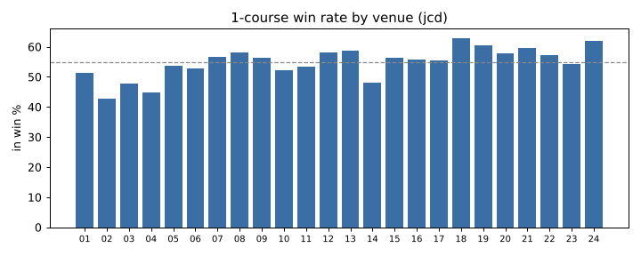
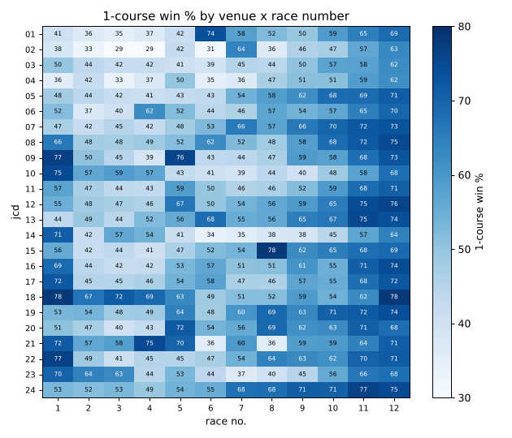

# 場 × コース × 条件 の基礎統計

期間 20231101〜20261101。`python scripts/analysis/venue_course.py --from 20231101 --to 20261101` で表を再生成（MANUAL ブロックは保持）。率は%、括弧内は母数、† は母数50未満で参考値。

**データ補正**: DB では唐津(23)の成績・払戻・レース情報が津(09)の場コードで入っている（取り込み不具合）。番組表の選手番号と照合し 272 日分を唐津に付け替えた（津のまま 592 日）。両場が同日開催だった日はどちらか一方の成績しか DB に残っていないため、津・唐津はほかの場より件数が少ない。

<!-- MANUAL START -->
## 0. 要約（手書き、2026-11-02 時点のデータ）

対象は 2023-11-01〜2026-11-01 の 162,856 レース（1着が確定したもの）。以下の数字はすべて下の自動集計表から取った。
単勝・2連単の回収率は**確定オッズ**で計算している。朝に買うときのオッズとは違う点に注意。

### 主な発見

1. **イン1着率は全国で 55.0%、場で 20 ポイント差がある。** 高い場: 徳山 62.8 / 大村 62.1 / 下関 60.4 / 芦屋 59.7。低い場: 戸田 42.9 / 平和島 44.8 / 江戸川 47.8 / 鳴門 48.0 / 桐生 51.3（各 n≈6,500〜7,300）。唐津 54.2（n=3,252）。
2. **進入はほぼ枠なり。** 全国の枠なり率は 80.3%、1号艇が1コースを取る率は 98.9%。前付けが多いのは浜名湖 27.7% / 唐津 27.4% / 常滑 27.0% / 桐生 26.2%。江戸川はほぼ前付けなし（枠なり 98.2%）。前付けが1号艇の勝ちを左右するのは1%程度（1号艇1着 54.5% に対しイン1着 55.0%）なので、前夜の予想では枠番＝コースとみなしてよい。
3. **風**（場ごとの向きは展示タイムから推定。2-0 を参照）: 風速0〜2m のイン 57.2%（n=80,294）→ 追い風5m以上 48.1%（n=10,125）、向かい風5m以上 50.5%（n=9,575）。追い風では差し（2C勝ち）が 13.2→16.8% に増え、向かい風では外（5-6C勝ち）が 7.5→10.4% に増えて平均STが 0.156→0.191 秒に遅くなる。教科書どおりの向きなので、向きの推定は妥当と判断した。例外は大村で、向かい風でもインが落ちない（3-4m 66.2%、5m以上 64.5%）。
4. **波高**: 0〜2cm 57.2% → 6〜9cm 48.8%。**天候**はほぼ無関係（晴 55.0 / 曇 55.3 / 雨 54.3）。**月**も全国では小さい（最低は7月 53.5、最高は3月 55.9）。
5. **レース番号と番組の作り（前夜に分かる）が最大の要因。** 全国のイン1着率は 12R 70.6 / 11R 67.0 / 1R 58.3 で、2〜4R は 46〜47%。場ごとの企画レースは大きく外れる: 丸亀 8R 78.0、津 1R 76.7・5R 75.9、三国 1R 74.8、芦屋 4R 75.1、桐生 6R 73.8、若松 5R 72.0、戸田 7R 63.8（戸田のほかのRは30%前後）。一方で芦屋 6R・8R は 35.8%、鳴門 6R は 33.7%。
6. **レース種別**: 予選 44.8%（n=60,344）、一般 54.8、特選・選抜系 61.8、準優勝戦 72.4、優勝戦 68.8、進入固定（若松のみ）73.5。
7. **1号艇の級別（番組表）**: 1号艇の1着率は A1 70.2% / A2 58.9 / B1 39.6 / B2 33.1。A1 で他の5艇に A1 がいなければ 74.2%。1号艇の全国勝率が他艇の最高より 1.5 以上高ければ 80.8%。場別で A1 が最も強いのは大村 76.2 / 徳山 74.3 / 津 73.9 / 常滑 73.7、弱いのは戸田 61.0 / 江戸川 62.1。
8. **ST・展示（当日情報）**: インのSTが外5艇の最速と同じかそれより速ければ 71.7%、外の誰かが 0.10 秒以上速ければ 20.2%。展示1位の艇の1着率は 27.1%、6位は 8.5%。インが展示1位なら 62.7%、6位なら 43.2%。
9. **配当**: 3連単は平均 7,217円・中央値 2,550円、万舟率 16.7%。荒れる場は鳴門 20.2 / 平和島 18.9 / 桐生 18.7 / 戸田 18.3 / 三国 18.2、堅い場は大村 14.3 / 徳山 14.4 / 福岡 14.5。万舟率は 2〜4R（17.8〜18.5%）、1号艇B級（18.2%）、強風（追い風5m以上 19.3%）で高い。
10. **控除率どおりにはなっていない券種がある**: 1号艇の単勝を全部買うと回収率は **90.4%**（3年とも 90.3〜90.5%）。2連単で1号艇から5点流すと 76.0%。3連単の控除率約25%と比べると、1号艇の単勝はかなり効率がよい（本命ほど回収率が高い「本命-大穴バイアス」）。

### 戦略に使えそうな仮説（バックテスト前。採用には `verify.py --backtest` が要る）

| # | 仮説 | 根拠（数字・n） | 前夜に判定できるか |
|---|---|---|---|
| H1 | **買い目の土台は「1号艇の単勝／1着固定」がいちばん損が小さい。** 3連単の広い買い方より、1号艇単勝にフィルタをかける方向から攻める | 1号艇単勝の回収率は全体で 90.4%（n=162,790）、3年とも ±0.1。2連単1-流しは 76.0% | ○ |
| H2 | **江戸川・徳山・尼崎・福岡では、1号艇がB1のとき単勝が過小評価されている**（人気が級別に引っ張られすぎている） | 1号艇B1の単勝回収率: 江戸川 100.3（n=3,193）/ 徳山 100.5（2,375）/ 尼崎 99.6（2,567）/ 福岡 97.3（2,671）、全国のB1は 91.6。4場まとめると 99.4%（n=10,806、年ごとに 100.4 / 99.3 / 98.7）。**時間で分けた検証**: 1年目の上位5場（尼崎・江戸川・徳山・常滑・多摩川）を2〜3年目に当てると 96.8%（n=9,435）、ほかの場は 90.1%。場の効果は続くが、100%には届いていない | ○ |
| H3 | **江戸川の1〜5Rは1号艇の単勝が100%前後** | 江戸川 1-5R の1号艇単勝は 101.3%（n=2,680）。年ごとに 104.4 / 103.8 / 95.5 で、直近は落ちている。6R以降は 90%前後 | ○ |
| H4 | **戸田・鳴門・桐生は1号艇を過大評価している**ので、1号艇から買うのを避ける（逆張りの候補） | 1号艇単勝: 戸田 82.8 / 鳴門 82.8 / 桐生 85.4（各 n≈6,500〜7,000、3年とも低い）。イン1着率も低い3場 | ○ |
| H5 | **企画レースはイン1着率が高いがオッズに織り込まれている。** 狙うなら回収率も高いものだけ | イン1着率が75%以上の企画R（丸亀8R・津1R/5R・芦屋4R・三国1R・徳山1R）の単勝回収率は 86.7〜98.0（三国1R 86.7、津1R 89.7、芦屋4R 89.6、丸亀8R 98.0）。100%を超えるセル（徳山5R 100.9、宮島6R 100.8、三国8R 106.8 など、各 n≈570）は 288 セルの多重比較なので偶然の可能性が高い | ○ |
| H6 | **強い追い風（5m以上）のときはインを切り、2コースからの差しを狙う** | 追い風5m以上でイン 48.1%、2C勝ち 16.8%（n=10,125。無風は 13.2%）。オッズへの織り込み具合は未検証。風は当日の情報 | ×（当日） |
| H7 | **当日運用にするなら、インの展示順位とSTが効く。** 1号艇を買うのはインが展示2位以内のときだけ、など | インの展示1位 62.7%、6位 43.2%（全国）。ST差の効果はさらに大きい（ただしSTはレース後にしか分からない） | ×（当日） |
| H8 | **穴狙いをするなら鳴門・平和島・桐生、2〜4R、1号艇B級、強風** | 万舟率は鳴門 20.2、2〜4R 17.8〜18.5、1号艇B1 18.2、追い風5m以上 19.3。全体は 16.7 | △ |
| H9 | **「1号艇A1で格上」だけでは勝てない**（当たるが儲からない） | A1で勝率差が1.0超のとき1着 約80%、単勝回収率 91.5%（n=6,641）。準優勝戦はイン 72.4%で単勝 90.7% | ○（不採用の根拠） |
| H10 | **大村は向かい風でもイン有利が崩れない**ので、風が強い日の大村1号艇は他場ほど割り引かなくてよい | 大村の向かい風3-4m 66.2%（n=630）、5m以上 64.5%（n=372）。無風は 61.9 | ×（当日） |

**次にやること**: H2・H3 は前夜のルールにでき、標本も大きい。`rules.yaml` に入れる前に、期間を分けたバックテスト（2023-11〜2025-10 で決めて 2025-11〜 で検証）を `verify.py --backtest` で回し、朝に買うときのオッズとの差（確定オッズより下がる方向）も見積もる。単勝で2〜3%の余裕しかないので、オッズの動きで消える可能性がある。

### データ上の注意（困ったこと）

- **唐津のデータが津として入っている**（取り込みの不具合と思われる）。races / results / payouts に jcd=23 が1件もなく、唐津の開催日は jcd=09 で入っている。両場が同じ日に開催した日は片方しか残っていない。このスクリプトでは番組表の選手番号と照合して日単位で付け替えた（ほぼ100%一致）。nightly の検証でも唐津と津の成績が混ざっている可能性が高い。
- **決まり手の列が無い**ので、1着コースで代用した。**ST にフライング・出遅れの区別が無い**（最小 0.00）。
- 風向は 1,3,…,15 の8方位（＋無風は NULL）と解釈した。コースの向きは公式の情報ではなく展示タイムから推定したもので、推定の当てはまりが弱い場（多摩川・常滑・徳山。振幅8ms/m以下）では「追い／向かい」の分類が怪しい。
<!-- MANUAL END -->

## 1. 場別・コース別（進入コース基準）

対象レース数（1着が確定したレース）: 162,856。率は%、括弧内は母数（そのコースから出た艇数／レース数）。† は母数50未満で参考。

### 1-1. コース別1着率（%）

| 場 | 1 | 2 | 3 | 4 | 5 | 6 |
|---|---|---|---|---|---|---|
| 桐生 | 51.3 (6961) | 12.3 (6961) | 13.2 (6961) | 12.8 (6961) | 8.1 (6959) | 2.3 (6888) |
| 戸田 | 42.9 (7032) | 17.3 (7032) | 15.9 (7031) | 14.1 (7031) | 7.3 (7031) | 2.5 (6956) |
| 江戸川 | 47.8 (6318) | 17.6 (6319) | 14.1 (6320) | 11.6 (6320) | 6.5 (6317) | 2.5 (6179) |
| 平和島 | 44.8 (6565) | 16.4 (6565) | 15.5 (6565) | 12.7 (6562) | 7.6 (6565) | 3.1 (6470) |
| 多摩川 | 53.6 (6853) | 14.2 (6853) | 12.8 (6853) | 10.9 (6853) | 6.5 (6851) | 2.1 (6781) |
| 浜名湖 | 52.9 (7348) | 13.8 (7348) | 14.4 (7348) | 10.4 (7347) | 6.9 (7346) | 1.7 (7239) |
| 蒲郡 | 56.7 (7102) | 11.6 (7102) | 12.6 (7103) | 11.7 (7103) | 5.5 (7102) | 1.9 (7017) |
| 常滑 | 58.2 (7368) | 12.3 (7368) | 10.4 (7368) | 11.0 (7368) | 6.2 (7366) | 2.0 (7300) |
| 津 | 56.5 (7056) | 13.4 (7056) | 11.8 (7056) | 10.1 (7054) | 6.3 (7055) | 1.9 (6975) |
| 三国 | 52.3 (6901) | 15.8 (6900) | 14.2 (6901) | 10.3 (6901) | 5.8 (6899) | 1.6 (6820) |
| びわこ | 53.4 (6644) | 14.1 (6645) | 13.9 (6646) | 10.6 (6646) | 6.4 (6646) | 1.7 (6564) |
| 住之江 | 58.2 (6923) | 13.5 (6923) | 11.7 (6923) | 9.6 (6923) | 5.3 (6922) | 1.6 (6859) |
| 尼崎 | 58.8 (7014) | 12.1 (7014) | 12.0 (7015) | 9.9 (7015) | 5.5 (7012) | 1.7 (6942) |
| 鳴門 | 48.0 (6525) | 14.9 (6525) | 15.3 (6525) | 11.9 (6525) | 7.8 (6523) | 2.2 (6424) |
| 丸亀 | 56.3 (7323) | 13.7 (7322) | 12.2 (7323) | 9.6 (7323) | 6.1 (7322) | 2.2 (7234) |
| 児島 | 55.8 (6840) | 12.9 (6840) | 12.9 (6839) | 10.3 (6840) | 5.8 (6840) | 2.3 (6775) |
| 宮島 | 55.5 (7163) | 12.7 (7164) | 12.9 (7163) | 10.5 (7163) | 6.6 (7164) | 1.9 (7054) |
| 徳山 | 62.8 (6822) | 13.0 (6822) | 10.1 (6822) | 8.5 (6822) | 4.5 (6822) | 1.1 (6744) |
| 下関 | 60.4 (6825) | 11.3 (6825) | 11.5 (6825) | 9.6 (6825) | 5.1 (6825) | 2.1 (6724) |
| 若松 | 57.8 (6852) | 12.3 (6853) | 11.8 (6853) | 10.1 (6852) | 5.9 (6852) | 2.1 (6780) |
| 芦屋 | 59.7 (6930) | 10.2 (6930) | 10.7 (6931) | 10.9 (6931) | 6.5 (6930) | 2.1 (6859) |
| 福岡 | 57.3 (6897) | 14.3 (6898) | 14.9 (6898) | 8.5 (6899) | 4.0 (6896) | 1.0 (6806) |
| 唐津 | 54.2 (3251) | 14.4 (3252) | 13.2 (3251) | 10.7 (3252) | 5.8 (3252) | 1.8 (3199) |
| 大村 | 62.1 (7329) | 12.1 (7331) | 10.9 (7331) | 8.7 (7331) | 4.9 (7331) | 1.4 (7280) |

### 1-2. コース別2着率（%）

| 場 | 1 | 2 | 3 | 4 | 5 | 6 |
|---|---|---|---|---|---|---|
| 桐生 | 18.5 (6961) | 24.2 (6961) | 21.7 (6961) | 14.9 (6961) | 14.2 (6959) | 6.6 (6888) |
| 戸田 | 18.3 (7032) | 23.3 (7032) | 20.0 (7031) | 16.8 (7031) | 14.3 (7031) | 7.4 (6956) |
| 江戸川 | 19.6 (6318) | 23.4 (6319) | 20.5 (6320) | 15.1 (6320) | 13.0 (6317) | 8.7 (6179) |
| 平和島 | 18.7 (6565) | 22.9 (6565) | 19.2 (6565) | 18.2 (6562) | 13.3 (6565) | 7.8 (6470) |
| 多摩川 | 16.7 (6853) | 24.8 (6853) | 21.4 (6853) | 17.0 (6853) | 13.1 (6851) | 7.1 (6781) |
| 浜名湖 | 17.8 (7348) | 25.1 (7348) | 21.6 (7348) | 16.8 (7347) | 12.7 (7346) | 6.2 (7239) |
| 蒲郡 | 16.2 (7102) | 24.4 (7102) | 22.8 (7103) | 18.1 (7103) | 13.6 (7102) | 5.0 (7017) |
| 常滑 | 15.8 (7368) | 24.4 (7368) | 22.3 (7368) | 17.8 (7368) | 13.4 (7366) | 6.2 (7300) |
| 津 | 17.5 (7056) | 26.6 (7056) | 20.6 (7056) | 17.0 (7054) | 12.4 (7055) | 6.0 (6975) |
| 三国 | 18.9 (6901) | 26.3 (6900) | 21.6 (6901) | 16.8 (6901) | 11.1 (6899) | 5.5 (6820) |
| びわこ | 18.6 (6644) | 25.0 (6645) | 21.4 (6646) | 16.6 (6646) | 12.7 (6646) | 5.8 (6564) |
| 住之江 | 16.3 (6923) | 25.1 (6923) | 23.0 (6923) | 18.4 (6923) | 11.6 (6922) | 5.8 (6859) |
| 尼崎 | 16.2 (7014) | 25.0 (7014) | 21.5 (7015) | 17.7 (7015) | 13.4 (7012) | 6.2 (6942) |
| 鳴門 | 18.3 (6525) | 24.1 (6525) | 20.2 (6525) | 17.4 (6525) | 13.0 (6523) | 7.0 (6424) |
| 丸亀 | 18.3 (7323) | 25.2 (7322) | 20.7 (7323) | 17.2 (7323) | 11.9 (7322) | 6.8 (7234) |
| 児島 | 17.7 (6840) | 24.6 (6840) | 20.1 (6839) | 18.9 (6840) | 12.0 (6840) | 6.8 (6775) |
| 宮島 | 16.5 (7163) | 24.8 (7164) | 23.0 (7163) | 16.6 (7163) | 13.0 (7164) | 6.3 (7054) |
| 徳山 | 16.5 (6822) | 28.2 (6822) | 22.4 (6822) | 16.5 (6822) | 11.6 (6822) | 4.7 (6744) |
| 下関 | 17.0 (6825) | 25.2 (6825) | 23.7 (6825) | 15.7 (6825) | 12.4 (6825) | 6.1 (6724) |
| 若松 | 16.9 (6852) | 24.5 (6853) | 22.8 (6853) | 17.3 (6852) | 12.0 (6852) | 6.5 (6780) |
| 芦屋 | 16.1 (6930) | 23.4 (6930) | 22.7 (6931) | 17.9 (6931) | 14.1 (6930) | 5.9 (6859) |
| 福岡 | 17.3 (6897) | 26.8 (6898) | 23.9 (6898) | 16.2 (6899) | 11.7 (6896) | 4.2 (6806) |
| 唐津 | 18.9 (3251) | 26.4 (3252) | 22.2 (3251) | 15.7 (3252) | 11.8 (3252) | 5.0 (3199) |
| 大村 | 16.7 (7329) | 26.4 (7331) | 23.9 (7331) | 16.0 (7331) | 11.4 (7331) | 5.6 (7280) |

### 1-3. コース別3着内率（%）

| 場 | 1 | 2 | 3 | 4 | 5 | 6 |
|---|---|---|---|---|---|---|
| 桐生 | 79.0 (6961) | 54.7 (6961) | 54.8 (6961) | 47.7 (6961) | 41.7 (6959) | 22.4 (6888) |
| 戸田 | 72.6 (7032) | 58.4 (7032) | 53.7 (7031) | 50.1 (7031) | 40.9 (7031) | 24.6 (6956) |
| 江戸川 | 78.0 (6318) | 59.2 (6319) | 53.6 (6320) | 44.3 (6320) | 37.9 (6317) | 27.6 (6179) |
| 平和島 | 75.2 (6565) | 58.5 (6565) | 52.9 (6565) | 49.0 (6562) | 38.3 (6565) | 26.5 (6470) |
| 多摩川 | 79.7 (6853) | 57.2 (6853) | 54.0 (6853) | 47.3 (6853) | 38.2 (6851) | 23.8 (6781) |
| 浜名湖 | 79.3 (7348) | 56.7 (7348) | 56.5 (7348) | 46.9 (7347) | 39.8 (7346) | 21.1 (7239) |
| 蒲郡 | 82.1 (7102) | 55.0 (7102) | 55.3 (7103) | 50.8 (7103) | 37.8 (7102) | 19.2 (7017) |
| 常滑 | 82.8 (7368) | 55.3 (7368) | 52.5 (7368) | 49.3 (7368) | 38.3 (7366) | 21.9 (7300) |
| 津 | 82.5 (7056) | 58.8 (7056) | 52.9 (7056) | 47.5 (7054) | 37.1 (7055) | 21.4 (6975) |
| 三国 | 79.8 (6901) | 60.2 (6900) | 55.5 (6901) | 48.0 (6901) | 35.6 (6899) | 21.1 (6820) |
| びわこ | 80.9 (6644) | 57.9 (6645) | 54.9 (6646) | 47.6 (6646) | 37.4 (6646) | 21.6 (6564) |
| 住之江 | 83.0 (6923) | 57.1 (6923) | 55.9 (6923) | 48.1 (6923) | 34.6 (6922) | 21.5 (6859) |
| 尼崎 | 83.5 (7014) | 55.0 (7014) | 54.1 (7015) | 49.1 (7015) | 36.7 (7012) | 21.8 (6942) |
| 鳴門 | 76.1 (6525) | 57.2 (6525) | 53.8 (6525) | 48.8 (6525) | 39.5 (6523) | 25.0 (6424) |
| 丸亀 | 82.5 (7323) | 57.3 (7322) | 52.5 (7323) | 48.5 (7323) | 35.0 (7322) | 24.3 (7234) |
| 児島 | 82.2 (6840) | 55.7 (6840) | 52.4 (6839) | 50.0 (6840) | 35.9 (6840) | 24.0 (6775) |
| 宮島 | 80.5 (7163) | 57.0 (7164) | 56.6 (7163) | 46.4 (7163) | 38.4 (7164) | 21.5 (7054) |
| 徳山 | 86.4 (6822) | 60.2 (6822) | 54.2 (6822) | 46.8 (6822) | 34.4 (6822) | 18.3 (6744) |
| 下関 | 85.6 (6825) | 56.1 (6825) | 56.1 (6825) | 45.8 (6825) | 35.5 (6825) | 21.2 (6724) |
| 若松 | 83.7 (6852) | 56.3 (6853) | 55.5 (6853) | 46.6 (6852) | 35.1 (6852) | 23.2 (6780) |
| 芦屋 | 84.3 (6930) | 52.7 (6930) | 52.7 (6931) | 48.0 (6931) | 39.7 (6930) | 22.9 (6859) |
| 福岡 | 83.3 (6897) | 61.2 (6898) | 58.0 (6898) | 47.0 (6899) | 34.2 (6896) | 16.6 (6806) |
| 唐津 | 82.3 (3251) | 59.5 (3252) | 55.7 (3251) | 47.6 (3252) | 37.1 (3252) | 18.1 (3199) |
| 大村 | 86.3 (7329) | 57.9 (7331) | 55.1 (7331) | 45.4 (7331) | 34.6 (7331) | 20.8 (7280) |

### 1-4. 決まり方の傾向（1着コースの構成と、イン逃げ時の2着コース）

決まり手そのものはデータに無いので、1着コースで代用（1コース1着≒逃げ、2コース≒差し/まくり、3〜4コース≒まくり/まくり差し、5〜6≒外の展開）。右側はイン（1コース）1着レースでの2着コース分布。

| 場 | レース | 1C勝 | 2C勝 | 3C勝 | 4C勝 | 5C勝 | 6C勝 | 逃げ時2着2C | 3C | 4C | 5C | 6C |
|---|---|---|---|---|---|---|---|---|---|---|---|---|
| 桐生 | 6961 | 51.3 | 12.3 | 13.2 | 12.8 | 8.1 | 2.3 | 34.2 | 30.3 | 17.7 | 12.6 | 5.1 |
| 戸田 | 7033 | 42.9 | 17.3 | 15.9 | 14.1 | 7.3 | 2.4 | 34.3 | 26.8 | 19.3 | 13.5 | 6.1 |
| 江戸川 | 6320 | 47.8 | 17.5 | 14.1 | 11.6 | 6.5 | 2.5 | 33.9 | 27.9 | 17.4 | 13.4 | 7.4 |
| 平和島 | 6565 | 44.8 | 16.4 | 15.5 | 12.7 | 7.6 | 3.0 | 31.4 | 27.4 | 21.5 | 13.2 | 6.5 |
| 多摩川 | 6853 | 53.6 | 14.2 | 12.8 | 10.9 | 6.5 | 2.1 | 34.1 | 28.4 | 18.7 | 12.7 | 6.1 |
| 浜名湖 | 7349 | 52.9 | 13.8 | 14.4 | 10.4 | 6.9 | 1.6 | 34.7 | 28.2 | 19.4 | 12.8 | 5.0 |
| 蒲郡 | 7103 | 56.7 | 11.6 | 12.6 | 11.7 | 5.5 | 1.9 | 32.6 | 30.2 | 20.5 | 12.6 | 4.1 |
| 常滑 | 7369 | 58.2 | 12.3 | 10.4 | 11.0 | 6.2 | 2.0 | 32.8 | 28.7 | 20.4 | 12.7 | 5.4 |
| 津 | 7056 | 56.5 | 13.4 | 11.8 | 10.1 | 6.3 | 1.9 | 36.0 | 27.2 | 19.1 | 12.3 | 5.4 |
| 三国 | 6901 | 52.3 | 15.8 | 14.2 | 10.3 | 5.8 | 1.6 | 36.5 | 28.3 | 19.7 | 10.7 | 4.6 |
| びわこ | 6646 | 53.4 | 14.1 | 13.9 | 10.6 | 6.4 | 1.7 | 34.7 | 28.9 | 19.5 | 12.0 | 4.9 |
| 住之江 | 6924 | 58.2 | 13.5 | 11.7 | 9.6 | 5.3 | 1.6 | 33.3 | 31.0 | 19.7 | 10.9 | 5.1 |
| 尼崎 | 7016 | 58.8 | 12.1 | 12.0 | 9.9 | 5.5 | 1.7 | 33.6 | 27.5 | 20.2 | 13.1 | 5.6 |
| 鳴門 | 6525 | 48.0 | 14.9 | 15.3 | 11.9 | 7.8 | 2.2 | 34.1 | 27.4 | 20.2 | 12.3 | 6.0 |
| 丸亀 | 7323 | 56.3 | 13.7 | 12.2 | 9.6 | 6.1 | 2.1 | 35.0 | 27.5 | 20.5 | 10.9 | 6.0 |
| 児島 | 6840 | 55.8 | 12.9 | 12.9 | 10.3 | 5.8 | 2.2 | 32.8 | 26.3 | 22.6 | 12.2 | 6.2 |
| 宮島 | 7164 | 55.5 | 12.7 | 12.9 | 10.5 | 6.6 | 1.9 | 33.5 | 30.6 | 18.7 | 12.1 | 5.2 |
| 徳山 | 6822 | 62.8 | 13.0 | 10.1 | 8.5 | 4.5 | 1.0 | 37.6 | 29.1 | 18.7 | 10.8 | 3.8 |
| 下関 | 6825 | 60.4 | 11.3 | 11.5 | 9.6 | 5.1 | 2.1 | 33.6 | 30.6 | 18.6 | 11.8 | 5.4 |
| 若松 | 6853 | 57.8 | 12.3 | 11.8 | 10.1 | 5.9 | 2.1 | 33.1 | 30.8 | 19.8 | 11.1 | 5.1 |
| 芦屋 | 6931 | 59.7 | 10.2 | 10.7 | 10.9 | 6.5 | 2.1 | 30.2 | 30.5 | 20.8 | 13.7 | 4.7 |
| 福岡 | 6899 | 57.3 | 14.3 | 14.9 | 8.5 | 4.0 | 1.0 | 37.0 | 31.7 | 17.2 | 10.9 | 3.1 |
| 唐津 | 3252 | 54.2 | 14.4 | 13.2 | 10.7 | 5.8 | 1.8 | 37.1 | 29.7 | 18.0 | 11.2 | 4.0 |
| 大村 | 7331 | 62.1 | 12.1 | 10.9 | 8.7 | 4.9 | 1.4 | 34.7 | 30.7 | 17.8 | 11.7 | 5.1 |
| 全国 | 162861 | 55.0 | 13.5 | 12.8 | 10.6 | 6.1 | 1.9 | 34.2 | 29.1 | 19.4 | 12.1 | 5.2 |

### 1-5. 3連単の出目（艇番）上位5と占有率

| 場 | レース | 1位 | 2位 | 3位 | 4位 | 5位 |
|---|---|---|---|---|---|---|
| 桐生 | 6959 | 1-2-3 6.4% | 1-3-2 5.0% | 1-2-4 4.6% | 1-3-4 4.3% | 1-2-5 3.7% |
| 戸田 | 7029 | 1-2-3 5.1% | 1-2-4 3.9% | 1-3-2 3.7% | 1-2-5 3.3% | 1-4-2 3.0% |
| 江戸川 | 6316 | 1-2-3 6.1% | 1-3-2 4.8% | 1-2-4 4.0% | 1-2-5 3.5% | 1-3-5 3.2% |
| 平和島 | 6561 | 1-2-3 4.8% | 1-3-2 4.6% | 1-2-4 3.6% | 1-3-4 3.5% | 1-4-2 3.2% |
| 多摩川 | 6852 | 1-2-3 6.8% | 1-3-2 5.2% | 1-2-4 4.7% | 1-3-4 4.2% | 1-2-5 3.9% |
| 浜名湖 | 7346 | 1-2-3 6.8% | 1-2-4 4.7% | 1-3-4 4.4% | 1-3-2 4.3% | 1-2-5 3.6% |
| 蒲郡 | 7098 | 1-2-3 6.7% | 1-3-4 5.5% | 1-3-2 5.5% | 1-2-4 4.8% | 1-2-5 3.7% |
| 常滑 | 7364 | 1-2-3 6.9% | 1-3-2 5.3% | 1-2-4 5.0% | 1-3-4 4.6% | 1-2-5 3.9% |
| 津 | 7053 | 1-2-3 7.8% | 1-2-4 5.7% | 1-3-2 5.3% | 1-3-4 4.1% | 1-2-5 3.8% |
| 三国 | 6900 | 1-2-3 7.0% | 1-2-4 5.4% | 1-3-2 4.9% | 1-3-4 4.4% | 1-2-5 3.9% |
| びわこ | 6644 | 1-2-3 6.6% | 1-2-4 5.4% | 1-3-2 5.2% | 1-3-4 4.7% | 1-2-5 3.7% |
| 住之江 | 6920 | 1-2-3 7.4% | 1-3-2 6.4% | 1-2-4 5.1% | 1-3-4 4.9% | 1-4-2 3.7% |
| 尼崎 | 7015 | 1-2-3 7.2% | 1-2-4 5.8% | 1-3-4 5.2% | 1-3-2 5.0% | 1-4-2 3.7% |
| 鳴門 | 6522 | 1-2-3 5.6% | 1-3-2 4.3% | 1-2-4 4.3% | 1-3-4 3.8% | 1-2-5 3.4% |
| 丸亀 | 7316 | 1-2-3 7.0% | 1-2-4 5.9% | 1-3-2 5.5% | 1-3-4 5.1% | 1-4-2 3.6% |
| 児島 | 6838 | 1-2-3 6.1% | 1-2-4 5.6% | 1-3-2 5.0% | 1-3-4 4.3% | 1-4-2 3.8% |
| 宮島 | 7160 | 1-2-3 7.4% | 1-3-2 6.3% | 1-2-4 4.7% | 1-3-4 4.5% | 1-4-2 3.5% |
| 徳山 | 6822 | 1-2-3 9.3% | 1-2-4 6.6% | 1-3-2 6.1% | 1-3-4 5.4% | 1-2-5 4.3% |
| 下関 | 6823 | 1-2-3 8.1% | 1-3-2 6.7% | 1-3-4 5.3% | 1-2-4 5.1% | 1-3-5 3.6% |
| 若松 | 6851 | 1-2-3 7.8% | 1-3-2 6.2% | 1-2-4 4.8% | 1-3-4 4.7% | 1-4-2 3.7% |
| 芦屋 | 6922 | 1-2-3 6.8% | 1-3-2 5.8% | 1-3-4 5.0% | 1-2-4 5.0% | 1-3-5 4.3% |
| 福岡 | 6899 | 1-2-3 8.1% | 1-3-2 6.8% | 1-2-4 6.3% | 1-3-4 5.2% | 1-2-5 4.0% |
| 唐津 | 3252 | 1-2-3 8.1% | 1-3-2 5.5% | 1-2-4 5.4% | 1-3-4 4.5% | 1-2-5 3.5% |
| 大村 | 7328 | 1-2-3 8.2% | 1-3-2 6.4% | 1-2-4 6.0% | 1-3-4 5.7% | 1-2-5 4.2% |
| 全国 | 162790 | 1-2-3 7.0% | 1-3-2 5.4% | 1-2-4 5.1% | 1-3-4 4.6% | 1-2-5 3.6% |

### 1-6. 枠番とコースのずれ（進入変化）

枠なり率=全艇が枠番どおりのコース。前付け発生率=枠番より内のコースに入った艇が1艇以上いるレース。1号艇イン率=1号艇が1コースを取った率。1号艇1着率とイン1着率の差がずれの影響。

| 場 | レース | 枠なり率 | 前付け発生率 | 1号艇イン率 | 1号艇1着率 | イン1着率 |
|---|---|---|---|---|---|---|
| 桐生 | 6961 | 73.8 | 26.2 | 97.2 | 50.1 | 51.3 |
| 戸田 | 7032 | 81.8 | 18.2 | 98.9 | 42.6 | 42.9 |
| 江戸川 | 6320 | 98.2 | 1.8 | 99.6 | 47.6 | 47.8 |
| 平和島 | 6565 | 81.4 | 18.6 | 99.1 | 44.5 | 44.8 |
| 多摩川 | 6853 | 83.1 | 16.9 | 99.5 | 53.5 | 53.6 |
| 浜名湖 | 7348 | 72.3 | 27.7 | 97.7 | 51.9 | 52.9 |
| 蒲郡 | 7103 | 75.2 | 24.8 | 98.0 | 55.8 | 56.7 |
| 常滑 | 7368 | 73.0 | 27.0 | 98.3 | 57.5 | 58.2 |
| 津 | 7056 | 83.2 | 16.8 | 99.4 | 56.3 | 56.5 |
| 三国 | 6901 | 74.4 | 25.6 | 98.7 | 51.8 | 52.3 |
| びわこ | 6646 | 89.7 | 10.3 | 99.6 | 53.3 | 53.4 |
| 住之江 | 6923 | 78.6 | 21.4 | 99.2 | 57.8 | 58.2 |
| 尼崎 | 7015 | 83.3 | 16.7 | 99.4 | 58.6 | 58.8 |
| 鳴門 | 6525 | 83.7 | 16.3 | 99.3 | 47.8 | 48.0 |
| 丸亀 | 7323 | 80.2 | 19.8 | 99.1 | 56.0 | 56.3 |
| 児島 | 6840 | 81.2 | 18.8 | 99.2 | 55.5 | 55.8 |
| 宮島 | 7164 | 79.1 | 20.9 | 99.1 | 55.2 | 55.5 |
| 徳山 | 6822 | 80.5 | 19.5 | 99.1 | 62.4 | 62.8 |
| 下関 | 6825 | 77.1 | 22.9 | 98.4 | 59.8 | 60.4 |
| 若松 | 6853 | 76.8 | 23.2 | 98.6 | 57.4 | 57.8 |
| 芦屋 | 6931 | 80.5 | 19.5 | 99.1 | 59.4 | 59.7 |
| 福岡 | 6899 | 81.6 | 18.4 | 99.0 | 57.1 | 57.3 |
| 唐津 | 3252 | 72.6 | 27.4 | 96.8 | 52.8 | 54.2 |
| 大村 | 7331 | 85.2 | 14.8 | 99.4 | 61.9 | 62.1 |
| 全国 | 162856 | 80.3 | 19.7 | 98.9 | 54.5 | 55.0 |

全国の枠番→進入コース（行%）:

| 枠 | 1C | 2C | 3C | 4C | 5C | 6C |
|---|---|---|---|---|---|---|
| 1号艇 | 99.03 | 0.82 | 0.09 | 0.03 | 0.02 | 0.02 |
| 2号艇 | 0.7 | 94.17 | 4.1 | 0.65 | 0.22 | 0.18 |
| 3号艇 | 0.16 | 1.91 | 92.04 | 4.57 | 0.9 | 0.42 |
| 4号艇 | 0.1 | 0.91 | 2.14 | 88.28 | 5.91 | 2.66 |
| 5号艇 | 0.09 | 1.09 | 0.86 | 4.62 | 83.64 | 9.69 |
| 6号艇 | 0.08 | 1.32 | 0.97 | 2.07 | 9.54 | 86.02 |

## 2. イン（1コース）1着率と条件

指標はすべて「1コースに入った艇が1着になった率」（%、括弧内レース数）。† は母数50未満で参考。

### 2-0. 風向コードの解釈と、場ごとの追い風方向の推定

- `wind_direction` は 1,3,5,…,15 の奇数のみ＋NULL。NULL は必ず風速0（無風）。16方位を北=1から時計回りに振った番号の8方位分と解釈した（1北, 3北東, 5東, 7南東, 9南, 11南西, 13西, 15北西）。値は気象の慣例どおり『風が吹いてくる方角』とみなす。
- 場のコースの向きはデータに無いので、**展示タイム**から推定した。展示タイムはバックストレッチ（1M→2M方向）で測るので、バックで向かい風になる風＝ホームストレッチ（スタート→1M）では追い風、になる。場×月で中心化したレース平均展示タイムを `風速 + 風速·cosθ + 風速·sinθ` に回帰し、展示が最も遅くなる風向を『追い風の吹いてくる方角』とした。
- 分類: 推定方向から±45°以内=追い、135°以上離れる=向かい、それ以外=横。振幅（風速1mあたりの展示タイム差の半分）が小さい場は向きの推定が怪しい。

展示偏差は風速4m以上のレースで、場×月平均との差（1/1000秒、+ が遅い）。

| 場 | 追い風の方角(推定) | コード | 振幅(ms/m) | 北(1) | 北東(3) | 東(5) | 南東(7) | 南(9) | 南西(11) | 西(13) | 北西(15) |
|---|---|---|---|---|---|---|---|---|---|---|---|
| 桐生 | 西北西 | 14.1 | 14.0 | - | - | -47 | -37 | - | - | +122 | +106 |
| 戸田 | 西 | 13.2 | 14.6 | +66 | -14 | -43 | -16 | +36 | +52 | +78 | +116 |
| 江戸川 | 南南西 | 9.9 | 18.3 | -87 | -93 | -43 | +3 | +133 | +52 | - | -14 |
| 平和島 | 南西 | 10.7 | 15.8 | -39 | -64 | - | +22 | +73 | +124 | - | -20 |
| 多摩川 | 東 | 5.4 | 5.1 | +15 | +28 | +35 | +25 | +11 | +6 | -6 | -22 |
| 浜名湖 | 北 | 16.7 | 14.6 | +107 | - | - | -47 | -31 | -26 | +70 | +103 |
| 蒲郡 | 北東 | 3.3 | 14.3 | - | - | +88 | +16 | -16 | -48 | -17 | +14 |
| 常滑 | 東 | 4.5 | 8.1 | -4 | - | +45 | +47 | +7 | -28 | -7 | -11 |
| 津 | 東南東 | 6.4 | 12.0 | - | - | +33 | +84 | - | - | -42 | -29 |
| 三国 | 北北西 | 15.6 | 15.6 | +99 | - | - | -65 | -37 | - | +65 | +80 |
| びわこ | 北 | 1.0 | 12.9 | +71 | +58 | +21 | -35 | -34 | -25 | +51 | +43 |
| 住之江 | 北北西 | 16.1 | 10.6 | +62 | +48 | - | - | -19 | - | - | - |
| 尼崎 | 北東 | 3.4 | 12.1 | +86 | +84 | +69 | +50 | -26 | -26 | -26 | +11 |
| 鳴門 | 西北西 | 13.8 | 10.6 | +14 | - | -69 | -17 | - | - | +48 | +81 |
| 丸亀 | 南南東 | 7.6 | 12.1 | -38 | +25 | +73 | +72 | +104 | +38 | -12 | -28 |
| 児島 | 北 | 1.5 | 12.4 | +96 | +87 | - | -21 | -22 | -43 | - | +62 |
| 宮島 | 北北東 | 2.3 | 13.9 | +115 | +93 | +75 | - | -39 | -34 | -15 | +51 |
| 徳山 | 南東 | 6.9 | 7.6 | -1 | +25 | +23 | +46 | +33 | +3 | -14 | -24 |
| 下関 | 東北東 | 3.5 | 12.7 | +58 | +91 | +36 | +12 | - | -27 | -38 | +1 |
| 若松 | 東 | 5.4 | 15.0 | +9 | +78 | +86 | +80 | - | -39 | -41 | -48 |
| 芦屋 | 西南西 | 12.0 | 15.4 | -21 | -48 | -55 | - | +46 | +82 | +87 | +42 |
| 福岡 | 西南西 | 12.0 | 16.6 | -8 | -41 | -46 | - | +68 | +94 | +100 | +61 |
| 唐津 | 北東 | 2.9 | 15.8 | +75 | +86 | - | - | -44 | -64 | -74 | - |
| 大村 | 南南西 | 10.3 | 17.0 | -39 | -28 | +22 | +53 | +80 | +141 | +73 | +40 |

### 2-1. 風（場ごとの相対風向 × 風速）

| 場 | 0-2m | 追い3-4m | 追い5m+ | 横3-4m | 横5m+ | 向かい3-4m | 向かい5m+ | 全体 |
|---|---|---|---|---|---|---|---|---|
| 桐生 | 54.0 (4125) | 47.3 (421) | 46.3 (814) | 43.8 (201) | 75.0† (4) | 48.1 (1211) | 48.0 (171) | 51.3 (6961) |
| 戸田 | 43.8 (4619) | 39.2 (367) | 38.5 (527) | 46.0 (433) | 38.2 (173) | 41.6 (681) | 43.1 (218) | 42.9 (7032) |
| 江戸川 | 48.0 (984) | 47.2 (687) | 46.0 (1528) | 49.3 (655) | 45.9 (503) | 49.3 (968) | 48.9 (978) | 47.8 (6320) |
| 平和島 | 45.0 (3314) | 46.8 (1137) | 47.4 (823) | 41.0 (205) | 43.8† (48) | 40.6 (678) | 42.0 (345) | 44.8 (6565) |
| 多摩川 | 54.0 (4370) | 53.7 (534) | 52.0 (100) | 53.4 (1188) | 51.9 (476) | 47.1 (102) | 50.0 (72) | 53.6 (6853) |
| 浜名湖 | 55.8 (2438) | 56.0 (723) | 49.7 (658) | 51.4 (923) | 42.5 (348) | 54.4 (1650) | 45.5 (605) | 52.9 (7348) |
| 蒲郡 | 59.8 (3821) | 60.1 (183) | 41.7† (48) | 55.2 (1730) | 49.0 (251) | 49.5 (858) | 50.7 (209) | 56.7 (7103) |
| 常滑 | 60.4 (3771) | 60.5 (86) | 45.5† (11) | 59.1 (1475) | 49.9 (704) | 58.3 (923) | 48.6 (381) | 58.2 (7368) |
| 津 | 58.9 (2859) | 54.2 (1770) | 54.3 (326) | 53.3† (15) | 0.0† (2) | 57.9 (1152) | 52.7 (928) | 56.5 (7056) |
| 三国 | 54.0 (2980) | 52.2 (1081) | 51.2 (856) | 53.3 (353) | 54.3 (105) | 52.5 (792) | 44.2 (577) | 52.3 (6901) |
| びわこ | 57.2 (3314) | 52.0 (1381) | 50.9 (265) | 48.1 (399) | 46.8 (94) | 49.1 (697) | 45.2 (438) | 53.4 (6646) |
| 住之江 | 59.3 (5232) | 56.4 (844) | 59.0 (234) | 56.0 (150) | 41.2† (17) | 50.4 (395) | 45.7† (46) | 58.2 (6923) |
| 尼崎 | 58.8 (2386) | 56.5 (595) | 52.7 (279) | 64.6 (506) | 54.4 (182) | 60.3 (1781) | 57.2 (1284) | 58.8 (7015) |
| 鳴門 | 51.3 (3338) | 45.1 (1044) | 41.1 (971) | 45.8 (118) | 50.0† (20) | 48.9 (820) | 38.3 (196) | 48.0 (6525) |
| 丸亀 | 59.4 (4139) | 46.8 (171) | 54.1† (37) | 53.8 (1117) | 54.3 (529) | 50.6 (719) | 51.1 (605) | 56.3 (7323) |
| 児島 | 59.2 (3356) | 57.1 (294) | 55.2 (181) | 52.0 (1428) | 47.5 (284) | 54.3 (1091) | 45.0 (191) | 55.8 (6840) |
| 宮島 | 58.3 (3836) | 53.1 (441) | 45.2 (263) | 49.6 (450) | 54.9 (142) | 54.6 (1678) | 49.4 (271) | 55.5 (7164) |
| 徳山 | 65.7 (3040) | 62.8 (729) | 55.2 (261) | 61.5 (1951) | 57.1 (483) | 60.5 (258) | 54.2 (59) | 62.8 (6822) |
| 下関 | 64.1 (3583) | 56.2 (912) | 52.1 (326) | 57.4 (884) | 53.7 (188) | 56.9 (631) | 54.7 (247) | 60.4 (6825) |
| 若松 | 62.5 (3061) | 52.9 (924) | 49.6 (486) | 58.8 (880) | 47.1 (187) | 56.6 (754) | 51.5 (534) | 57.8 (6853) |
| 芦屋 | 62.8 (2892) | 56.6 (557) | 51.1 (440) | 61.1 (1302) | 57.5 (273) | 57.6 (922) | 54.3 (484) | 59.7 (6931) |
| 福岡 | 58.2 (2774) | 55.8 (328) | 57.0 (107) | 58.3 (2613) | 57.9 (261) | 51.3 (663) | 54.1 (135) | 57.3 (6899) |
| 唐津 | 60.3 (1031) | 50.8 (728) | 48.0 (513) | 46.4 (166) | 73.9† (23) | 56.3 (542) | 52.0 (229) | 54.2 (3252) |
| 大村 | 61.9 (5031) | 55.8 (190) | 50.7 (71) | 61.7 (712) | 60.8 (306) | 66.2 (630) | 64.5 (372) | 62.1 (7331) |
| 全国 | 57.2 (80294) | 52.7 (16127) | 48.1 (10125) | 56.0 (19854) | 51.5 (5603) | 53.6 (20596) | 50.5 (9575) | 55.0 (162856) |

向きの推定の検算（全国）: 追い風では差し（2C勝ち）が増えて平均STが速く、向かい風では外（5-6C勝ち）が増えて平均STが遅くなるはず。

| 風 | レース | 1C勝% | 2C勝% | 3C勝% | 4C勝% | 5-6C勝% | 平均ST |
|---|---|---|---|---|---|---|---|
| 0-2m | 80294 | 57.2 | 13.2 | 12.2 | 10.0 | 7.5 | 0.156 |
| 追い3-4m | 16127 | 52.7 | 15.4 | 13.3 | 10.7 | 7.9 | 0.153 |
| 追い5m+ | 10125 | 48.1 | 16.8 | 14.5 | 12.0 | 8.5 | 0.165 |
| 横3-4m | 19854 | 56.0 | 13.3 | 12.6 | 10.6 | 7.6 | 0.165 |
| 横5m+ | 5603 | 51.5 | 14.0 | 14.5 | 11.9 | 8.1 | 0.179 |
| 向かい3-4m | 20596 | 53.6 | 12.2 | 13.3 | 11.5 | 9.4 | 0.175 |
| 向かい5m+ | 9575 | 50.5 | 13.4 | 13.9 | 11.7 | 10.4 | 0.191 |

### 2-2. 波高

| 場 | 0-2cm | 3-5cm | 6-9cm | 10cm+ | 全体 |
|---|---|---|---|---|---|
| 桐生 | 52.5 (5291) | 48.1 (1151) | 46.3 (486) | 26.3† (19) | 51.2 (6947) |
| 戸田 | 43.4 (5513) | 41.1 (1286) | 40.6 (192) | 40.7† (27) | 42.9 (7018) |
| 江戸川 | - | 48.1 (4229) | - | 46.9 (2074) | 47.7 (6303) |
| 平和島 | 46.6 (73) | 44.8 (6319) | 43.9 (157) | 100.0† (1) | 44.8 (6550) |
| 多摩川 | 53.6 (5984) | 53.8 (794) | 41.3† (46) | 72.2† (18) | 53.6 (6842) |
| 浜名湖 | 54.5 (5878) | 46.5 (1467) | - | - | 52.9 (7345) |
| 蒲郡 | 57.2 (6704) | 48.7 (396) | - | - | 56.7 (7100) |
| 常滑 | 59.8 (6201) | 50.1 (1056) | 46.8 (94) | - | 58.2 (7351) |
| 津 | 57.2 (5796) | 53.5 (1237) | 21.1† (19) | - | 56.5 (7052) |
| 三国 | 53.9 (2993) | 52.3 (2850) | 48.0 (854) | 25.5† (47) | 52.3 (6744) |
| びわこ | 56.4 (3536) | 50.3 (2639) | 48.1 (368) | 57.8† (45) | 53.5 (6588) |
| 住之江 | 58.2 (6828) | 56.7 (90) | - | - | 58.2 (6918) |
| 尼崎 | 59.6 (5268) | 56.0 (1612) | 59.5 (131) | 0.0† (2) | 58.8 (7013) |
| 鳴門 | 51.3 (3338) | 45.9 (2413) | 40.3 (732) | 29.2† (24) | 48.0 (6507) |
| 丸亀 | 59.4 (4139) | 52.0 (2470) | 53.1 (700) | 50.0† (8) | 56.3 (7317) |
| 児島 | 61.1 (1274) | 54.7 (5530) | 42.9† (21) | - | 55.8 (6825) |
| 宮島 | 58.4 (3802) | 53.0 (3045) | 45.3 (234) | - | 55.6 (7081) |
| 徳山 | 65.7 (3040) | 60.8 (3543) | 56.9 (197) | 0.0† (1) | 62.9 (6781) |
| 下関 | 64.1 (3583) | 56.1 (2930) | 54.3 (258) | - | 60.3 (6771) |
| 若松 | 62.5 (3061) | 55.1 (3193) | 48.8 (568) | 50.0† (4) | 57.9 (6826) |
| 芦屋 | 62.8 (2892) | 58.2 (3549) | 51.6 (426) | 100.0† (3) | 59.7 (6870) |
| 福岡 | 58.2 (2773) | 56.7 (3971) | 58.4 (137) | - | 57.3 (6881) |
| 唐津 | 60.3 (1031) | 52.8 (1824) | 46.1 (371) | 0.0† (6) | 54.3 (3232) |
| 大村 | 62.3 (6047) | 60.8 (972) | 61.4 (293) | - | 62.1 (7312) |
| 全国 | 57.2 (95045) | 52.4 (58566) | 48.8 (6284) | 46.4 (2279) | 55.0 (162174) |

### 2-3. 天候

| 場 | 晴 | 曇 | 雨 | 全体 |
|---|---|---|---|---|
| 桐生 | 49.8 (3272) | 52.1 (2921) | 54.1 (754) | 51.2 (6947) |
| 戸田 | 41.9 (4329) | 44.7 (1999) | 43.9 (690) | 42.9 (7018) |
| 江戸川 | 47.0 (3849) | 49.5 (1902) | 46.4 (552) | 47.7 (6303) |
| 平和島 | 46.4 (3606) | 44.5 (2280) | 37.8 (664) | 44.8 (6550) |
| 多摩川 | 52.9 (3905) | 54.5 (2310) | 54.1 (627) | 53.6 (6842) |
| 浜名湖 | 52.1 (5039) | 55.0 (1688) | 54.0 (618) | 52.9 (7345) |
| 蒲郡 | 57.4 (4310) | 55.9 (2022) | 54.9 (768) | 56.7 (7100) |
| 常滑 | 58.6 (5031) | 58.4 (1720) | 54.2 (600) | 58.2 (7351) |
| 津 | 55.1 (4400) | 59.4 (1799) | 57.4 (853) | 56.5 (7052) |
| 三国 | 52.1 (3628) | 52.7 (2238) | 52.2 (878) | 52.3 (6744) |
| びわこ | 53.4 (4321) | 53.8 (1638) | 53.1 (629) | 53.5 (6588) |
| 住之江 | 58.9 (4232) | 58.1 (2011) | 54.1 (675) | 58.2 (6918) |
| 尼崎 | 58.6 (4501) | 59.5 (1986) | 58.0 (526) | 58.8 (7013) |
| 鳴門 | 47.5 (4407) | 49.2 (1580) | 47.9 (520) | 48.0 (6507) |
| 丸亀 | 56.8 (4435) | 55.7 (2076) | 55.5 (806) | 56.3 (7317) |
| 児島 | 55.5 (4527) | 57.4 (1705) | 53.6 (593) | 55.8 (6825) |
| 宮島 | 54.9 (4354) | 57.0 (2071) | 56.1 (656) | 55.6 (7081) |
| 徳山 | 62.4 (4532) | 63.7 (1693) | 64.0 (556) | 62.9 (6781) |
| 下関 | 61.1 (4087) | 58.3 (1978) | 61.0 (706) | 60.3 (6771) |
| 若松 | 58.0 (4629) | 58.9 (1570) | 54.5 (627) | 57.9 (6826) |
| 芦屋 | 59.3 (4465) | 59.3 (1665) | 63.2 (740) | 59.7 (6870) |
| 福岡 | 58.6 (4292) | 55.7 (1937) | 54.4 (652) | 57.3 (6881) |
| 唐津 | 53.6 (2209) | 55.6 (667) | 56.2 (356) | 54.3 (3232) |
| 大村 | 62.0 (4428) | 63.6 (1890) | 59.3 (994) | 62.1 (7312) |
| 全国 | 55.0 (100788) | 55.3 (45346) | 54.3 (16040) | 55.0 (162174) |

### 2-4. 月

| 場 | 1 | 2 | 3 | 4 | 5 | 6 | 7 | 8 | 9 | 10 | 11 | 12 | 全体 |
|---|---|---|---|---|---|---|---|---|---|---|---|---|---|
| 桐生 | 50.0 (576) | 52.9 (575) | 47.1 (493) | 54.1 (540) | 50.7 (702) | 49.0 (647) | 52.3 (644) | 51.9 (636) | 51.3 (468) | 48.2 (612) | 55.2 (540) | 53.0 (528) | 51.3 (6961) |
| 戸田 | 42.4 (648) | 43.8 (564) | 42.5 (637) | 42.8 (540) | 39.0 (575) | 44.6 (588) | 39.3 (540) | 45.2 (648) | 41.4 (408) | 45.7 (540) | 45.0 (624) | 42.1 (720) | 42.9 (7032) |
| 江戸川 | 48.9 (595) | 50.3 (597) | 50.4 (561) | 46.2 (403) | 45.0 (451) | 45.9 (556) | 49.8 (454) | 48.7 (454) | 47.0 (568) | 47.3 (565) | 47.2 (468) | 46.1 (648) | 47.8 (6320) |
| 平和島 | 44.4 (612) | 46.8 (528) | 47.7 (631) | 45.6 (636) | 45.7 (492) | 44.2 (360) | 44.9 (670) | 40.9 (696) | 42.4 (576) | 48.9 (444) | 42.6 (420) | 44.6 (500) | 44.8 (6565) |
| 多摩川 | 51.1 (642) | 54.7 (455) | 53.9 (514) | 53.4 (539) | 55.8 (600) | 56.8 (600) | 52.1 (624) | 51.8 (564) | 53.1 (636) | 54.5 (516) | 54.4 (551) | 51.8 (612) | 53.6 (6853) |
| 浜名湖 | 52.4 (696) | 55.4 (570) | 53.0 (721) | 51.2 (644) | 51.7 (555) | 55.5 (564) | 52.3 (648) | 47.8 (696) | 51.8 (599) | 55.7 (672) | 55.9 (383) | 54.2 (600) | 52.9 (7348) |
| 蒲郡 | 56.5 (720) | 57.1 (624) | 54.6 (648) | 54.7 (572) | 58.6 (713) | 50.5 (552) | 57.8 (516) | 54.4 (456) | 58.3 (384) | 62.6 (612) | 57.7 (598) | 56.6 (708) | 56.7 (7103) |
| 常滑 | 53.3 (516) | 55.8 (550) | 59.5 (642) | 58.9 (632) | 56.8 (720) | 57.7 (648) | 62.5 (696) | 59.2 (612) | 61.9 (588) | 58.3 (552) | 58.7 (588) | 54.6 (624) | 58.2 (7368) |
| 津 | 57.6 (712) | 60.2 (274) | 58.0 (479) | 57.1 (624) | 56.2 (751) | 56.5 (768) | 51.2 (598) | 53.8 (676) | 56.3 (616) | 58.5 (744) | 59.3 (371) | 56.0 (443) | 56.5 (7056) |
| 三国 | 53.6 (474) | 53.1 (448) | 53.6 (661) | 50.8 (535) | 51.3 (636) | 50.5 (660) | 48.8 (611) | 57.4 (624) | 53.1 (573) | 50.5 (582) | 52.2 (552) | 53.8 (545) | 52.3 (6901) |
| びわこ | 56.3 (666) | 56.0 (636) | 46.7 (450) | 54.2 (192) | 48.3 (729) | 52.0 (636) | 52.7 (622) | 53.1 (651) | 58.5 (624) | 56.4 (636) | 53.7 (300) | 52.2 (504) | 53.4 (6646) |
| 住之江 | 60.2 (636) | 56.7 (600) | 59.5 (432) | 62.3 (612) | 65.5 (623) | 54.0 (576) | 49.9 (696) | 56.9 (492) | 52.9 (456) | 56.5 (696) | 61.1 (504) | 63.0 (600) | 58.2 (6923) |
| 尼崎 | 58.1 (704) | 56.3 (588) | 61.4 (660) | 60.6 (480) | 59.3 (636) | 61.4 (744) | 56.3 (744) | 58.0 (647) | 58.5 (492) | 58.0 (348) | 59.2 (360) | 58.2 (612) | 58.8 (7015) |
| 鳴門 | 48.5 (652) | 45.3 (600) | 41.7 (132) | 51.6 (564) | 46.4 (586) | 49.6 (516) | 51.3 (522) | 49.3 (600) | 49.0 (516) | 47.3 (636) | 47.2 (600) | 44.3 (601) | 48.0 (6525) |
| 丸亀 | 50.1 (678) | 56.6 (662) | 61.7 (577) | 56.6 (516) | 60.2 (684) | 55.2 (516) | 55.2 (540) | 59.7 (636) | 56.9 (540) | 52.9 (575) | 57.9 (687) | 52.9 (712) | 56.3 (7323) |
| 児島 | 55.1 (744) | 56.0 (672) | 60.1 (552) | 59.3 (432) | 55.6 (732) | 58.0 (672) | 55.3 (756) | 56.6 (684) | 49.3 (408) | 50.9 (456) | 51.5 (132) | 56.8 (600) | 55.8 (6840) |
| 宮島 | 53.0 (570) | 54.6 (564) | 54.8 (693) | 57.5 (670) | 57.9 (684) | 57.7 (480) | 54.4 (528) | 55.6 (624) | 55.4 (648) | 51.5 (264) | 54.1 (684) | 56.7 (755) | 55.5 (7164) |
| 徳山 | 64.7 (708) | 64.1 (516) | 64.0 (456) | 62.5 (312) | 66.3 (430) | 58.9 (620) | 64.3 (624) | 60.9 (672) | 66.3 (492) | 60.2 (588) | 64.8 (648) | 59.7 (756) | 62.8 (6822) |
| 下関 | 63.9 (768) | 58.3 (576) | 61.9 (501) | 62.4 (396) | 59.8 (564) | 57.5 (504) | 55.6 (648) | 63.8 (624) | 60.5 (600) | 57.4 (528) | 60.5 (456) | 62.6 (660) | 60.4 (6825) |
| 若松 | 61.2 (541) | 62.2 (481) | 57.5 (581) | 57.9 (648) | 56.4 (562) | 56.0 (672) | 55.5 (678) | 55.4 (720) | 56.6 (624) | 58.2 (323) | 60.0 (555) | 60.0 (468) | 57.8 (6853) |
| 芦屋 | 60.5 (516) | 56.7 (527) | 63.8 (672) | 60.5 (588) | 60.3 (624) | 57.3 (480) | 51.9 (576) | 60.6 (644) | 62.5 (600) | 59.0 (432) | 60.7 (708) | 60.3 (564) | 59.7 (6931) |
| 福岡 | 57.9 (516) | 58.3 (228) | 58.0 (659) | 61.9 (672) | 57.6 (408) | 52.8 (504) | 56.4 (684) | 57.1 (564) | 57.9 (684) | 55.3 (696) | 56.0 (636) | 58.3 (648) | 57.3 (6899) |
| 唐津 | 53.1 (228) | 58.3 (480) | 59.8 (239) | 52.1 (234) | 51.9 (156) | 54.5 (211) | 47.7 (348) | 54.2 (360) | 51.6 (252) | 59.0 (144) | 53.3 (180) | 54.3 (420) | 54.2 (3252) |
| 大村 | 67.4 (684) | 66.4 (444) | 61.6 (672) | 62.5 (659) | 59.9 (516) | 58.0 (590) | 60.7 (636) | 55.6 (611) | 63.2 (636) | 63.3 (684) | 63.0 (576) | 63.2 (623) | 62.1 (7331) |
| 全国 | 55.2 (14802) | 55.3 (12759) | 55.9 (13263) | 55.8 (12640) | 55.0 (14129) | 54.2 (13664) | 53.5 (14603) | 54.5 (14591) | 55.2 (12988) | 54.8 (12845) | 55.8 (12121) | 54.8 (14451) | 55.0 (162856) |

### 2-5. レース番号

| 場 | 1 | 2 | 3 | 4 | 5 | 6 | 7 | 8 | 9 | 10 | 11 | 12 | 全体 |
|---|---|---|---|---|---|---|---|---|---|---|---|---|---|
| 桐生 | 40.5 (585) | 36.4 (585) | 34.8 (584) | 36.6 (584) | 41.6 (584) | 73.8 (583) | 58.0 (579) | 52.2 (577) | 49.6 (577) | 59.2 (576) | 64.9 (575) | 68.5 (572) | 51.3 (6961) |
| 戸田 | 38.2 (587) | 32.5 (587) | 28.6 (587) | 29.0 (587) | 42.4 (587) | 31.1 (586) | 63.8 (586) | 36.1 (585) | 46.0 (585) | 47.4 (585) | 56.6 (585) | 63.1 (585) | 42.9 (7032) |
| 江戸川 | 49.9 (541) | 43.8 (537) | 42.0 (536) | 42.1 (535) | 40.6 (534) | 39.4 (533) | 45.1 (530) | 44.3 (524) | 50.2 (520) | 57.4 (514) | 57.7 (508) | 62.4 (508) | 47.8 (6320) |
| 平和島 | 35.6 (548) | 41.8 (548) | 33.2 (548) | 37.0 (548) | 49.9 (547) | 34.7 (548) | 36.5 (548) | 47.0 (547) | 51.1 (546) | 51.1 (546) | 58.6 (546) | 61.7 (545) | 44.8 (6565) |
| 多摩川 | 47.9 (572) | 43.9 (572) | 41.6 (572) | 41.2 (571) | 42.8 (572) | 43.2 (572) | 54.2 (572) | 58.5 (571) | 62.0 (571) | 68.1 (571) | 68.6 (570) | 71.1 (567) | 53.6 (6853) |
| 浜名湖 | 51.6 (616) | 37.0 (616) | 40.5 (615) | 62.2 (614) | 52.0 (614) | 44.4 (613) | 46.1 (614) | 56.9 (612) | 53.8 (611) | 56.7 (608) | 64.6 (608) | 69.5 (607) | 52.9 (7348) |
| 蒲郡 | 46.7 (593) | 41.8 (593) | 44.9 (593) | 42.4 (592) | 47.9 (593) | 52.6 (593) | 65.7 (592) | 57.2 (591) | 65.8 (591) | 69.8 (590) | 72.3 (591) | 73.3 (591) | 56.7 (7103) |
| 常滑 | 65.9 (616) | 47.9 (616) | 47.7 (616) | 48.7 (616) | 51.6 (616) | 62.3 (615) | 52.4 (614) | 48.3 (613) | 58.3 (612) | 68.3 (612) | 72.2 (611) | 75.0 (611) | 58.2 (7368) |
| 津 | 76.7 (592) | 50.3 (592) | 44.7 (591) | 38.9 (591) | 75.9 (588) | 43.3 (589) | 44.0 (587) | 46.7 (587) | 59.0 (586) | 57.8 (586) | 67.8 (584) | 72.9 (583) | 56.5 (7056) |
| 三国 | 74.8 (579) | 56.6 (579) | 58.7 (579) | 57.0 (579) | 42.7 (578) | 40.7 (578) | 39.4 (574) | 43.9 (572) | 40.4 (572) | 48.4 (570) | 57.6 (571) | 67.7 (570) | 52.3 (6901) |
| びわこ | 57.4 (556) | 46.9 (556) | 43.5 (556) | 43.0 (556) | 58.6 (556) | 49.6 (556) | 45.8 (553) | 46.5 (553) | 51.7 (553) | 59.2 (551) | 68.4 (550) | 70.7 (550) | 53.4 (6646) |
| 住之江 | 54.8 (577) | 48.4 (577) | 47.1 (577) | 46.1 (577) | 66.6 (577) | 49.9 (577) | 53.6 (576) | 56.3 (577) | 59.4 (577) | 65.3 (577) | 74.5 (577) | 75.9 (577) | 58.2 (6923) |
| 尼崎 | 43.9 (586) | 49.2 (585) | 44.2 (586) | 52.2 (586) | 55.6 (586) | 68.1 (586) | 55.3 (584) | 56.3 (584) | 64.8 (583) | 66.6 (583) | 75.3 (583) | 73.9 (583) | 58.8 (7015) |
| 鳴門 | 71.2 (548) | 42.0 (548) | 56.6 (548) | 53.8 (546) | 41.0 (546) | 33.7 (546) | 35.4 (542) | 37.5 (541) | 38.3 (541) | 44.5 (541) | 57.1 (539) | 64.2 (539) | 48.0 (6525) |
| 丸亀 | 55.6 (615) | 41.7 (614) | 43.6 (614) | 40.7 (615) | 46.7 (615) | 52.0 (615) | 53.8 (610) | 78.0 (608) | 62.5 (605) | 65.1 (604) | 68.0 (604) | 69.0 (604) | 56.3 (7323) |
| 児島 | 68.8 (570) | 44.2 (570) | 41.9 (570) | 42.3 (570) | 53.0 (570) | 56.7 (570) | 50.7 (570) | 51.2 (570) | 61.1 (570) | 54.7 (570) | 70.9 (570) | 74.4 (570) | 55.8 (6840) |
| 宮島 | 72.2 (597) | 45.1 (597) | 45.0 (598) | 46.5 (598) | 53.8 (598) | 57.7 (598) | 46.7 (598) | 46.2 (597) | 57.1 (597) | 55.3 (597) | 68.1 (595) | 72.4 (594) | 55.5 (7164) |
| 徳山 | 78.0 (569) | 67.0 (569) | 71.5 (569) | 68.9 (569) | 63.1 (569) | 48.5 (569) | 51.5 (569) | 51.7 (569) | 59.2 (568) | 54.4 (568) | 62.4 (567) | 78.0 (567) | 62.8 (6822) |
| 下関 | 53.2 (570) | 53.8 (569) | 48.3 (569) | 48.5 (569) | 64.3 (569) | 48.0 (569) | 60.3 (569) | 69.1 (569) | 63.4 (568) | 70.6 (568) | 71.7 (568) | 74.1 (568) | 60.4 (6825) |
| 若松 | 50.5 (576) | 47.0 (574) | 40.0 (573) | 42.8 (572) | 72.0 (572) | 53.8 (571) | 56.0 (570) | 69.1 (570) | 61.5 (569) | 62.6 (569) | 70.7 (569) | 68.1 (568) | 57.8 (6853) |
| 芦屋 | 72.0 (578) | 56.6 (578) | 58.3 (578) | 75.1 (578) | 70.1 (578) | 35.8 (578) | 59.5 (578) | 35.8 (578) | 58.6 (577) | 59.1 (577) | 64.3 (577) | 71.0 (576) | 59.7 (6931) |
| 福岡 | 76.5 (575) | 48.5 (575) | 40.9 (575) | 45.4 (575) | 44.9 (575) | 47.1 (575) | 54.4 (575) | 64.3 (574) | 62.8 (575) | 61.6 (575) | 70.1 (575) | 71.3 (575) | 57.3 (6899) |
| 唐津 | 70.2 (272) | 64.3 (272) | 62.7 (271) | 44.5 (272) | 52.9 (272) | 43.8 (272) | 36.5 (271) | 40.0 (270) | 45.2 (270) | 55.9 (270) | 66.3 (270) | 67.8 (270) | 54.2 (3252) |
| 大村 | 53.0 (611) | 51.6 (612) | 53.0 (611) | 49.4 (611) | 54.0 (611) | 55.3 (611) | 67.6 (611) | 68.1 (611) | 71.0 (611) | 70.5 (611) | 76.6 (611) | 74.7 (609) | 62.1 (7331) |
| 全国 | 58.3 (13629) | 47.0 (13621) | 46.0 (13616) | 47.4 (13611) | 53.5 (13607) | 48.8 (13603) | 51.8 (13572) | 53.0 (13550) | 56.8 (13535) | 59.8 (13519) | 67.0 (13504) | 70.6 (13489) | 55.0 (162856) |

### 2-6. レース種別（race_name を分類）

分類: 準優/優勝/ドリーム/進入固定 は名前で、特選・特賞・選抜・特別・記者 を含むもの=特選・選抜系、残りで 予選/一般、どれでもない場独自の企画レース名（『サンライズ』『ドラドキ』等）=企画・その他。

| 場 | 予選 | 一般 | 特選・選抜系 | 準優勝戦 | 優勝戦 | ドリーム | 進入固定 | 企画・その他 | 全体 |
|---|---|---|---|---|---|---|---|---|---|
| 桐生 | 35.8 (2128) | 47.4 (1100) | 58.8 (1602) | 66.4 (304) | 71.2 (104) | 66.0 (106) | - | 61.8 (1617) | 51.3 (6961) |
| 戸田 | 31.9 (2689) | 38.7 (1342) | 51.9 (1765) | 64.5 (197) | 57.8 (116) | 100.0† (4) | - | 56.9 (919) | 42.9 (7032) |
| 江戸川 | 42.9 (3187) | 46.7 (1371) | 57.0 (1502) | 62.8 (148) | 56.7 (97) | 33.3† (6) | - | 66.7† (9) | 47.8 (6320) |
| 平和島 | 34.3 (2468) | 40.7 (1458) | 54.2 (1656) | 66.1 (218) | 60.4 (101) | - | - | 60.4 (664) | 44.8 (6565) |
| 多摩川 | 46.3 (3095) | 50.0 (1697) | 67.8 (1380) | 71.6 (306) | 70.8 (106) | 60.0 (110) | - | 59.1 (159) | 53.6 (6853) |
| 浜名湖 | 41.0 (2790) | 52.2 (1426) | 58.3 (1613) | 72.1 (283) | 70.9 (110) | 62.3 (106) | - | 69.7 (1020) | 52.9 (7348) |
| 蒲郡 | 47.6 (3152) | 56.0 (1866) | 69.6 (1512) | 73.9 (352) | 74.3 (105) | 81.6 (103) | - | 61.5† (13) | 56.7 (7103) |
| 常滑 | 50.0 (2820) | 54.3 (1808) | 66.8 (1440) | 76.5 (349) | 75.4 (122) | 73.0 (111) | - | 68.8 (718) | 58.2 (7368) |
| 津 | 40.7 (2656) | 58.6 (1310) | 61.9 (1505) | 78.2 (266) | 64.7 (102) | 68.6 (70) | - | 77.1 (1147) | 56.5 (7056) |
| 三国 | 40.8 (1907) | 51.0 (1123) | 51.0 (1550) | 67.3 (312) | 58.9 (107) | 67.7† (31) | - | 62.9 (1871) | 52.3 (6901) |
| びわこ | 45.0 (2940) | 56.5 (1677) | 60.5 (1313) | 70.0 (297) | 76.5 (98) | 71.4† (14) | - | 62.2 (307) | 53.4 (6646) |
| 住之江 | 49.4 (2655) | 57.3 (1584) | 65.0 (1490) | 72.0 (300) | 75.9 (108) | 67.9 (53) | - | 69.0 (733) | 58.2 (6923) |
| 尼崎 | 49.1 (2602) | 63.1 (1387) | 68.6 (1546) | 79.3 (290) | 68.2 (107) | 78.6† (14) | - | 55.7 (1069) | 58.8 (7015) |
| 鳴門 | 39.9 (1916) | 43.5 (1225) | 48.0 (1176) | 66.9 (308) | 60.0 (105) | 63.2 (117) | - | 55.1 (1678) | 48.0 (6525) |
| 丸亀 | 43.0 (2274) | 57.1 (1446) | 64.6 (1328) | 71.3 (390) | 73.0 (111) | 66.9 (124) | - | 61.8 (1650) | 56.3 (7323) |
| 児島 | 44.6 (2317) | 61.0 (1217) | 62.2 (1471) | 76.6 (295) | 76.8 (99) | 77.8† (9) | - | 57.1 (1432) | 55.8 (6840) |
| 宮島 | 41.6 (2730) | 57.4 (1336) | 62.8 (1526) | 71.9 (313) | 77.9 (104) | 73.1 (52) | - | 69.7 (1103) | 55.5 (7164) |
| 徳山 | 54.4 (2970) | 68.5 (1647) | 63.9 (1152) | 79.1 (321) | 71.0 (100) | 77.2 (184) | - | 75.4 (448) | 62.8 (6822) |
| 下関 | 52.2 (2634) | 61.2 (1605) | 67.1 (1302) | 76.0 (350) | 76.4 (110) | 70.7 (116) | - | 65.3 (708) | 60.4 (6825) |
| 若松 | 47.9 (2352) | 53.3 (1458) | 63.6 (1425) | 71.2 (351) | 69.3 (101) | 68.6 (102) | 73.5 (520) | 69.9 (544) | 57.8 (6853) |
| 芦屋 | 48.0 (1419) | 46.1 (804) | 62.1 (1456) | 69.8 (318) | 61.2 (103) | 69.6 (92) | - | 66.8 (2739) | 59.7 (6931) |
| 福岡 | 46.5 (2601) | 62.3 (1350) | 65.4 (1554) | 72.3 (292) | 70.7 (99) | 67.0 (88) | - | 59.7 (915) | 57.3 (6899) |
| 唐津 | 45.0 (927) | 49.0 (535) | 59.5 (585) | 68.7 (163) | 65.2† (46) | 57.6 (59) | - | 59.7 (937) | 54.2 (3252) |
| 大村 | 52.0 (3115) | 65.5 (2076) | 72.5 (1526) | 79.1 (402) | 65.5 (113) | 66.7† (3) | - | 75.0 (96) | 62.1 (7331) |
| 全国 | 44.8 (60344) | 54.8 (33848) | 61.8 (34375) | 72.4 (7125) | 68.8 (2474) | 68.9 (1674) | 73.5 (520) | 63.6 (22496) | 55.0 (162856) |

### 2-7. 1号艇の級別（番組表 entries）

番組表と結果が両方あるレース: 162,856（期間内全体の100%）。左はイン1着率、右は1号艇1着率（前夜に買える指標）。

| 場 | A1 | A2 | B1 | B2 | 全体 | 1号艇1着 A1 | 1号艇1着 A2 | 1号艇1着 B1 | 1号艇1着 B2 | 1号艇1着 全体 |
|---|---|---|---|---|---|---|---|---|---|---|
| 桐生 | 69.0 (2190) | 54.6 (1849) | 36.2 (2706) | 31.0 (216) | 51.3 (6961) | 68.6 (2190) | 53.8 (1849) | 34.3 (2706) | 28.2 (216) | 50.1 (6961) |
| 戸田 | 61.1 (2067) | 47.1 (1724) | 29.4 (3052) | 23.8 (189) | 42.9 (7032) | 61.0 (2067) | 46.8 (1724) | 29.1 (3052) | 23.8 (189) | 42.6 (7032) |
| 江戸川 | 62.3 (1402) | 52.9 (1479) | 40.2 (3196) | 32.5 (243) | 47.8 (6320) | 62.1 (1402) | 52.8 (1479) | 40.1 (3196) | 32.5 (243) | 47.6 (6320) |
| 平和島 | 63.3 (1856) | 49.8 (1588) | 31.6 (2925) | 27.0 (196) | 44.8 (6565) | 63.1 (1856) | 49.4 (1588) | 31.1 (2925) | 26.5 (196) | 44.5 (6565) |
| 多摩川 | 69.4 (1907) | 59.7 (1701) | 41.2 (3028) | 38.2 (217) | 53.6 (6853) | 69.2 (1907) | 59.7 (1701) | 41.2 (3028) | 38.2 (217) | 53.5 (6853) |
| 浜名湖 | 69.7 (2138) | 55.7 (1825) | 41.1 (3208) | 34.5 (177) | 52.9 (7348) | 69.7 (2138) | 55.0 (1825) | 39.3 (3208) | 32.8 (177) | 51.9 (7348) |
| 蒲郡 | 72.1 (2330) | 60.3 (1930) | 41.8 (2673) | 37.6 (170) | 56.7 (7103) | 71.9 (2330) | 59.1 (1930) | 40.7 (2673) | 36.5 (170) | 55.8 (7103) |
| 常滑 | 74.1 (2414) | 63.3 (1998) | 41.9 (2789) | 39.5 (167) | 58.2 (7368) | 73.7 (2414) | 63.2 (1998) | 40.6 (2789) | 35.9 (167) | 57.5 (7368) |
| 津 | 74.1 (2295) | 61.3 (1868) | 40.2 (2730) | 25.2 (163) | 56.5 (7056) | 73.9 (2295) | 61.3 (1868) | 39.9 (2730) | 23.9 (163) | 56.3 (7056) |
| 三国 | 66.5 (2183) | 56.8 (1938) | 38.7 (2611) | 29.6 (169) | 52.3 (6901) | 66.2 (2183) | 56.1 (1938) | 37.9 (2611) | 28.4 (169) | 51.8 (6901) |
| びわこ | 68.4 (2095) | 57.9 (1851) | 39.1 (2562) | 31.2 (138) | 53.4 (6646) | 68.2 (2095) | 57.9 (1851) | 39.1 (2562) | 30.4 (138) | 53.3 (6646) |
| 住之江 | 71.3 (2591) | 61.1 (1770) | 43.3 (2405) | 35.7 (157) | 58.2 (6923) | 71.1 (2591) | 61.0 (1770) | 42.5 (2405) | 35.7 (157) | 57.8 (6923) |
| 尼崎 | 73.6 (2532) | 63.1 (1748) | 42.5 (2567) | 38.7 (168) | 58.8 (7015) | 73.6 (2532) | 63.0 (1748) | 42.0 (2567) | 38.7 (168) | 58.6 (7015) |
| 鳴門 | 64.1 (1950) | 53.3 (1742) | 33.8 (2681) | 30.3 (152) | 48.0 (6525) | 63.8 (1950) | 53.3 (1742) | 33.4 (2681) | 30.3 (152) | 47.8 (6525) |
| 丸亀 | 71.8 (2497) | 57.3 (1905) | 42.9 (2753) | 34.5 (168) | 56.3 (7323) | 71.7 (2497) | 57.2 (1905) | 42.4 (2753) | 34.5 (168) | 56.0 (7323) |
| 児島 | 72.1 (2250) | 59.6 (1896) | 39.8 (2572) | 34.4 (122) | 55.8 (6840) | 72.0 (2250) | 59.4 (1896) | 39.2 (2572) | 32.8 (122) | 55.5 (6840) |
| 宮島 | 69.7 (2402) | 62.7 (1915) | 39.2 (2673) | 29.3 (174) | 55.5 (7164) | 69.6 (2402) | 62.6 (1915) | 38.6 (2673) | 29.3 (174) | 55.2 (7164) |
| 徳山 | 74.5 (2378) | 67.9 (1943) | 48.3 (2375) | 39.7 (126) | 62.8 (6822) | 74.3 (2378) | 67.8 (1943) | 47.3 (2375) | 38.9 (126) | 62.4 (6822) |
| 下関 | 73.4 (2205) | 63.1 (2128) | 47.0 (2346) | 41.1 (146) | 60.4 (6825) | 72.7 (2205) | 62.7 (2128) | 46.3 (2346) | 39.7 (146) | 59.8 (6825) |
| 若松 | 71.6 (2423) | 58.0 (2110) | 43.6 (2187) | 39.1 (133) | 57.8 (6853) | 71.2 (2423) | 57.8 (2110) | 42.9 (2187) | 38.3 (133) | 57.4 (6853) |
| 芦屋 | 70.3 (2667) | 60.3 (2448) | 43.0 (1718) | 48.0 (98) | 59.7 (6931) | 70.2 (2667) | 60.3 (2448) | 42.2 (1718) | 44.9 (98) | 59.4 (6931) |
| 福岡 | 72.6 (2197) | 63.0 (1861) | 42.0 (2671) | 37.6 (170) | 57.3 (6899) | 72.5 (2197) | 62.9 (1861) | 41.6 (2671) | 37.6 (170) | 57.1 (6899) |
| 唐津 | 69.6 (1064) | 59.1 (885) | 38.7 (1238) | 29.2 (65) | 54.2 (3252) | 68.9 (1064) | 58.3 (885) | 36.3 (1238) | 29.2 (65) | 52.8 (3252) |
| 大村 | 76.3 (2455) | 65.3 (2093) | 47.5 (2651) | 37.9 (132) | 62.1 (7331) | 76.2 (2455) | 65.2 (2093) | 47.2 (2651) | 36.4 (132) | 61.9 (7331) |
| 全国 | 70.4 (52488) | 59.1 (44195) | 40.4 (62317) | 34.0 (3856) | 55.0 (162856) | 70.2 (52488) | 58.9 (44195) | 39.6 (62317) | 33.1 (3856) | 54.5 (162856) |

## 3. スタートタイミング・展示タイム

ST はフライング・出遅れの区別がデータに無い（最小0.00）。F/L 艇は着順 NULL で残るが ST の値の意味が不明なので、ここでは着順のある艇のみ。

### 3-1. コース別の平均ST（秒）

| 場 | 1C | 2C | 3C | 4C | 5C | 6C |
|---|---|---|---|---|---|---|
| 桐生 | 0.163 | 0.174 | 0.165 | 0.161 | 0.16 | 0.177 |
| 戸田 | 0.152 | 0.16 | 0.154 | 0.159 | 0.166 | 0.184 |
| 江戸川 | 0.158 | 0.169 | 0.169 | 0.18 | 0.192 | 0.213 |
| 平和島 | 0.143 | 0.153 | 0.148 | 0.148 | 0.152 | 0.17 |
| 多摩川 | 0.158 | 0.168 | 0.16 | 0.154 | 0.157 | 0.173 |
| 浜名湖 | 0.15 | 0.163 | 0.159 | 0.168 | 0.172 | 0.191 |
| 蒲郡 | 0.155 | 0.167 | 0.161 | 0.16 | 0.164 | 0.181 |
| 常滑 | 0.153 | 0.171 | 0.169 | 0.174 | 0.176 | 0.191 |
| 津 | 0.148 | 0.158 | 0.155 | 0.16 | 0.165 | 0.183 |
| 三国 | 0.15 | 0.163 | 0.159 | 0.162 | 0.168 | 0.182 |
| びわこ | 0.151 | 0.167 | 0.165 | 0.177 | 0.181 | 0.195 |
| 住之江 | 0.15 | 0.157 | 0.15 | 0.143 | 0.147 | 0.166 |
| 尼崎 | 0.17 | 0.175 | 0.164 | 0.16 | 0.162 | 0.176 |
| 鳴門 | 0.142 | 0.154 | 0.148 | 0.148 | 0.153 | 0.172 |
| 丸亀 | 0.147 | 0.162 | 0.156 | 0.158 | 0.163 | 0.178 |
| 児島 | 0.15 | 0.161 | 0.154 | 0.149 | 0.153 | 0.171 |
| 宮島 | 0.149 | 0.163 | 0.16 | 0.167 | 0.169 | 0.183 |
| 徳山 | 0.154 | 0.164 | 0.158 | 0.159 | 0.163 | 0.181 |
| 下関 | 0.152 | 0.163 | 0.155 | 0.159 | 0.162 | 0.174 |
| 若松 | 0.155 | 0.166 | 0.161 | 0.163 | 0.168 | 0.186 |
| 芦屋 | 0.147 | 0.159 | 0.153 | 0.154 | 0.158 | 0.177 |
| 福岡 | 0.151 | 0.161 | 0.157 | 0.17 | 0.173 | 0.189 |
| 唐津 | 0.144 | 0.156 | 0.155 | 0.161 | 0.166 | 0.178 |
| 大村 | 0.138 | 0.152 | 0.148 | 0.153 | 0.157 | 0.17 |
| 全国 | 0.151 | 0.163 | 0.158 | 0.16 | 0.164 | 0.181 |

### 3-2. 自艇のST帯 × コース の1着率（全国）

| ST帯 | 1 | 2 | 3 | 4 | 5 | 6 | 全体 |
|---|---|---|---|---|---|---|---|
| ≤0.09 | 69.2 (33274) | 20.3 (24470) | 18.2 (28372) | 19.5 (28010) | 10.9 (25412) | 5.1 (20162) | 26.6 (159700) |
| 0.10-0.12 | 64.4 (26500) | 16.6 (23706) | 15.7 (25515) | 13.8 (24409) | 7.7 (23443) | 2.7 (18594) | 21.6 (142167) |
| 0.13-0.15 | 60.2 (29919) | 15.0 (29935) | 13.9 (29847) | 11.1 (29363) | 6.9 (28723) | 2.0 (24676) | 18.8 (172463) |
| 0.16-0.18 | 54.0 (26576) | 13.0 (29165) | 11.8 (28001) | 8.8 (27590) | 5.3 (27963) | 1.7 (26429) | 15.6 (165724) |
| ≥0.19 | 38.2 (44714) | 9.0 (53817) | 8.7 (49051) | 5.3 (51597) | 3.5 (55207) | 0.9 (68953) | 9.8 (323339) |
| 全国 | 55.6 (160983) | 13.7 (161093) | 13.0 (160786) | 10.7 (160969) | 6.2 (160748) | 2.0 (158814) | 16.9 (963393) |

### 3-3. レース内のST順位 × コース の1着率（全国、1=最速、同タイムは上位扱い）

| ST順位 | 1 | 2 | 3 | 4 | 5 | 6 | 全体 |
|---|---|---|---|---|---|---|---|
| 1 | 72.7 (51799) | 25.2 (25188) | 22.4 (31035) | 25.3 (32180) | 14.4 (28319) | 6.5 (24111) | 33.6 (192632) |
| 2 | 60.8 (27688) | 16.3 (33800) | 15.8 (33285) | 14.1 (28596) | 8.8 (29557) | 3.0 (19130) | 20.2 (172056) |
| 3 | 54.1 (22943) | 13.3 (27874) | 11.9 (34870) | 9.2 (29813) | 5.7 (25560) | 1.9 (19878) | 15.4 (160938) |
| 4 | 46.2 (21001) | 11.4 (25756) | 10.4 (26471) | 4.6 (31278) | 3.4 (28403) | 1.2 (23117) | 11.6 (156026) |
| 5 | 39.6 (19458) | 9.2 (26148) | 6.5 (19464) | 3.0 (21700) | 2.1 (32070) | 0.8 (28744) | 8.8 (147584) |
| 6 | 28.9 (18094) | 5.2 (22327) | 3.4 (15661) | 1.6 (17402) | 1.2 (16839) | 0.3 (43834) | 5.6 (134157) |
| 全国 | 55.6 (160983) | 13.7 (161093) | 13.0 (160786) | 10.7 (160969) | 6.2 (160748) | 2.0 (158814) | 16.9 (963393) |

### 3-4. インのSTと外5艇の最速STの差 → イン1着率（全国）

| ST差 | イン1着率 |
|---|---|
| 外が0.10以上速い | 20.2 (21390) |
| 外が0.05-0.09速い | 43.9 (34879) |
| 外が0.01-0.04速い | 61.0 (52915) |
| 同〜インが0.04速い | 71.7 (43206) |
| インが0.05-0.09速い | 77.1 (7997) |
| インが0.10以上速い | 81.5 (596) |

### 3-5. 展示タイム順位（レース内、1=最速）と着順（全国）

| 展示順位 | 艇数 | 1着率 | 2着率 | 3着内率 |
|---|---|---|---|---|
| 1 | 185889 | 27.1 | 18.8 | 61.7 |
| 2 | 174497 | 20.3 | 18.5 | 56.0 |
| 3 | 165857 | 16.4 | 17.5 | 51.3 |
| 4 | 158350 | 13.6 | 16.3 | 47.2 |
| 5 | 150537 | 11.1 | 15.0 | 42.8 |
| 6 | 139955 | 8.5 | 13.0 | 37.1 |

### 3-6. 展示順位 × コース の1着率（全国）

| 展示順位 | 1 | 2 | 3 | 4 | 5 | 6 | 全体 |
|---|---|---|---|---|---|---|---|
| 1 | 62.7 (49118) | 19.8 (31343) | 18.9 (27157) | 17.3 (26372) | 10.3 (24729) | 3.8 (27170) | 27.1 (185889) |
| 2 | 56.4 (36056) | 15.1 (31208) | 14.9 (28509) | 13.1 (27120) | 7.4 (25960) | 2.3 (25644) | 20.3 (174497) |
| 3 | 53.0 (27558) | 13.1 (29139) | 13.2 (28545) | 10.5 (27909) | 5.9 (27111) | 1.8 (25595) | 16.4 (165857) |
| 4 | 50.3 (21478) | 11.5 (26484) | 11.4 (28192) | 9.0 (28043) | 5.4 (27875) | 1.6 (26278) | 13.6 (158350) |
| 5 | 47.0 (16584) | 10.2 (23920) | 9.9 (26360) | 7.6 (27847) | 4.7 (28883) | 1.3 (26943) | 11.1 (150537) |
| 6 | 43.2 (12048) | 8.8 (20754) | 8.0 (24088) | 6.2 (25556) | 3.7 (28270) | 0.9 (29239) | 8.5 (139955) |
| 全国 | 55.0 (162842) | 13.5 (162848) | 12.8 (162851) | 10.6 (162847) | 6.1 (162828) | 1.9 (160869) | 16.7 (975085) |

### 3-7. 場別: インの展示順位別イン1着率

| 場 | 1位 | 2-3位 | 4-5位 | 6位 | 全体 |
|---|---|---|---|---|---|
| 桐生 | 56.9 (1835) | 52.4 (2681) | 47.4 (1774) | 41.3 (671) | 51.3 (6961) |
| 戸田 | 48.8 (2552) | 42.9 (2526) | 36.3 (1455) | 31.5 (499) | 42.9 (7032) |
| 江戸川 | 53.7 (1646) | 48.0 (2401) | 44.5 (1662) | 40.1 (609) | 47.8 (6318) |
| 平和島 | 51.3 (1963) | 44.4 (2536) | 40.4 (1538) | 35.8 (528) | 44.8 (6565) |
| 多摩川 | 63.6 (2049) | 53.4 (2698) | 45.5 (1627) | 38.8 (479) | 53.6 (6853) |
| 浜名湖 | 60.9 (2186) | 53.5 (2868) | 46.5 (1721) | 38.6 (573) | 52.9 (7348) |
| 蒲郡 | 65.6 (2387) | 55.6 (2832) | 47.4 (1485) | 45.0 (398) | 56.7 (7102) |
| 常滑 | 66.8 (1985) | 58.3 (2960) | 52.3 (1821) | 47.3 (602) | 58.2 (7368) |
| 津 | 65.2 (1933) | 56.1 (2768) | 51.2 (1788) | 45.5 (567) | 56.5 (7056) |
| 三国 | 58.4 (1958) | 53.5 (2606) | 46.9 (1749) | 43.4 (588) | 52.3 (6901) |
| びわこ | 60.8 (1949) | 52.6 (2517) | 49.8 (1614) | 42.4 (564) | 53.4 (6644) |
| 住之江 | 65.7 (2271) | 57.7 (2721) | 51.2 (1520) | 44.8 (411) | 58.2 (6923) |
| 尼崎 | 66.7 (2106) | 60.3 (2820) | 50.4 (1620) | 42.9 (468) | 58.8 (7014) |
| 鳴門 | 54.6 (2282) | 46.4 (2562) | 42.9 (1310) | 35.8 (371) | 48.0 (6525) |
| 丸亀 | 63.2 (2546) | 55.6 (2915) | 48.1 (1467) | 47.8 (395) | 56.3 (7323) |
| 児島 | 63.4 (1834) | 55.1 (2562) | 51.7 (1778) | 48.8 (666) | 55.8 (6840) |
| 宮島 | 64.7 (1940) | 55.9 (2723) | 49.1 (1877) | 44.3 (623) | 55.5 (7163) |
| 徳山 | 72.7 (2353) | 61.4 (2767) | 53.9 (1317) | 43.6 (385) | 62.8 (6822) |
| 下関 | 66.6 (2107) | 60.1 (2716) | 55.2 (1548) | 51.8 (454) | 60.4 (6825) |
| 若松 | 66.5 (1960) | 56.9 (2725) | 52.8 (1674) | 45.4 (493) | 57.8 (6852) |
| 芦屋 | 69.8 (2043) | 59.0 (2757) | 53.0 (1629) | 43.7 (501) | 59.7 (6930) |
| 福岡 | 64.7 (2180) | 56.8 (2674) | 51.4 (1577) | 45.9 (466) | 57.3 (6897) |
| 唐津 | 62.2 (931) | 53.6 (1335) | 48.0 (744) | 46.1 (241) | 54.2 (3251) |
| 大村 | 71.1 (2122) | 63.0 (2944) | 53.5 (1767) | 48.6 (496) | 62.1 (7329) |
| 全国 | 62.7 (49118) | 54.9 (63614) | 48.9 (38062) | 43.2 (12048) | 55.0 (162842) |

## 4. 配当の分布

払戻は100円あたり。平均/中央値は的中組番ごとの行で計算（複勝・ワイドは1レース複数行）。万舟率=3連単払戻≥10,000円のレース比率。

### 4-1. 場別・券種別 平均 / 中央値（円）と万舟率

| 場 | 単勝 | 複勝 | 2連単 | 2連複 | ワイド | 3連単 | 3連複 | 万舟率% | 3連単90%点 | レース |
|---|---|---|---|---|---|---|---|---|---|---|
| 桐生 | 430 / 220 | 218 / 140 | 1,912 / 880 | 953 / 500 | 359 / 250 | 7,661 / 3,010 | 1,262 / 690 | 18.7 | 17,168 | 6959 |
| 戸田 | 434 / 260 | 207 / 150 | 1,847 / 990 | 934 / 550 | 355 / 260 | 7,424 / 3,350 | 1,246 / 750 | 18.3 | 16,116 | 7029 |
| 江戸川 | 429 / 250 | 204 / 140 | 1,802 / 930 | 941 / 510 | 359 / 260 | 7,156 / 3,220 | 1,231 / 720 | 17.9 | 16,070 | 6316 |
| 平和島 | 445 / 260 | 214 / 150 | 1,904 / 1,000 | 973 / 550 | 363 / 260 | 7,410 / 3,400 | 1,292 / 740 | 18.9 | 17,110 | 6561 |
| 多摩川 | 398 / 210 | 200 / 130 | 1,752 / 790 | 918 / 460 | 356 / 240 | 6,941 / 2,610 | 1,238 / 650 | 16.6 | 15,939 | 6852 |
| 浜名湖 | 430 / 210 | 200 / 130 | 1,836 / 790 | 930 / 460 | 360 / 250 | 7,286 / 2,610 | 1,199 / 650 | 17.2 | 16,465 | 7346 |
| 蒲郡 | 390 / 190 | 206 / 120 | 1,679 / 700 | 867 / 430 | 345 / 230 | 6,667 / 2,280 | 1,163 / 590 | 15.1 | 14,843 | 7098 |
| 常滑 | 400 / 190 | 191 / 120 | 1,799 / 690 | 910 / 440 | 361 / 230 | 6,924 / 2,310 | 1,184 / 600 | 15.0 | 14,667 | 7364 |
| 津 | 433 / 190 | 193 / 120 | 1,862 / 720 | 915 / 440 | 369 / 240 | 7,222 / 2,450 | 1,225 / 620 | 16.2 | 16,100 | 7053 |
| 三国 | 427 / 210 | 194 / 130 | 1,899 / 800 | 932 / 460 | 355 / 240 | 7,596 / 2,745 | 1,251 / 640 | 18.2 | 17,634 | 6900 |
| びわこ | 426 / 200 | 197 / 130 | 1,813 / 740 | 922 / 440 | 359 / 240 | 7,166 / 2,495 | 1,248 / 610 | 16.2 | 15,597 | 6644 |
| 住之江 | 394 / 180 | 184 / 120 | 1,896 / 680 | 931 / 420 | 352 / 230 | 7,613 / 2,345 | 1,241 / 610 | 16.3 | 16,060 | 6920 |
| 尼崎 | 388 / 170 | 187 / 120 | 1,780 / 650 | 908 / 430 | 353 / 230 | 6,968 / 2,190 | 1,196 / 600 | 15.1 | 14,966 | 7015 |
| 鳴門 | 431 / 230 | 203 / 140 | 1,983 / 910 | 1,006 / 520 | 373 / 260 | 8,163 / 3,200 | 1,353 / 730 | 20.2 | 18,890 | 6522 |
| 丸亀 | 389 / 200 | 196 / 120 | 1,826 / 730 | 937 / 430 | 355 / 240 | 7,352 / 2,540 | 1,255 / 640 | 17.0 | 16,365 | 7316 |
| 児島 | 436 / 200 | 219 / 130 | 1,972 / 760 | 977 / 460 | 367 / 240 | 7,610 / 2,595 | 1,292 / 650 | 17.6 | 17,189 | 6838 |
| 宮島 | 415 / 200 | 210 / 130 | 1,878 / 730 | 979 / 450 | 363 / 240 | 7,385 / 2,480 | 1,240 / 640 | 17.8 | 17,660 | 7160 |
| 徳山 | 370 / 160 | 181 / 110 | 1,648 / 590 | 853 / 380 | 342 / 220 | 6,662 / 1,990 | 1,143 / 550 | 14.4 | 14,969 | 6822 |
| 下関 | 372 / 180 | 186 / 120 | 1,688 / 660 | 869 / 410 | 343 / 230 | 6,508 / 2,270 | 1,127 / 580 | 15.5 | 14,870 | 6823 |
| 若松 | 403 / 190 | 186 / 120 | 1,864 / 730 | 954 / 440 | 353 / 240 | 7,332 / 2,550 | 1,219 / 640 | 17.4 | 16,860 | 6851 |
| 芦屋 | 392 / 160 | 204 / 110 | 1,899 / 660 | 951 / 430 | 361 / 240 | 7,868 / 2,300 | 1,262 / 610 | 17.1 | 17,409 | 6922 |
| 福岡 | 398 / 190 | 192 / 120 | 1,693 / 670 | 876 / 420 | 358 / 230 | 6,566 / 2,240 | 1,152 / 580 | 14.5 | 14,004 | 6899 |
| 唐津 | 413 / 200 | 187 / 120 | 1,829 / 720 | 892 / 430 | 353 / 240 | 7,506 / 2,495 | 1,219 / 600 | 16.9 | 16,548 | 3252 |
| 大村 | 348 / 170 | 173 / 120 | 1,602 / 590 | 819 / 380 | 337 / 220 | 6,482 / 2,080 | 1,151 / 570 | 14.3 | 14,069 | 7328 |
| 全国 | 408 / 200 | 197 / 130 | 1,818 / 750 | 923 / 450 | 356 / 240 | 7,217 / 2,550 | 1,224 / 630 | 16.7 | 16,160 | 162790 |

### 4-2. 万舟率 × レース番号

| 場 | 1 | 2 | 3 | 4 | 5 | 6 | 7 | 8 | 9 | 10 | 11 | 12 | 全体 |
|---|---|---|---|---|---|---|---|---|---|---|---|---|---|
| 桐生 | 22.6 (585) | 18.8 (584) | 20.9 (584) | 24.8 (584) | 19.9 (584) | 14.1 (583) | 17.4 (579) | 17.5 (577) | 17.3 (577) | 19.4 (576) | 15.5 (575) | 15.8 (571) | 18.7 (6959) |
| 戸田 | 18.9 (587) | 16.2 (587) | 18.4 (587) | 16.9 (587) | 17.5 (587) | 17.4 (586) | 17.6 (585) | 17.6 (584) | 19.3 (584) | 21.5 (585) | 19.0 (585) | 19.0 (585) | 18.3 (7029) |
| 江戸川 | 16.8 (541) | 17.4 (536) | 21.5 (536) | 18.4 (534) | 17.6 (533) | 17.3 (533) | 16.8 (530) | 16.4 (524) | 18.5 (520) | 19.5 (514) | 16.1 (508) | 18.3 (507) | 17.9 (6316) |
| 平和島 | 17.4 (547) | 19.9 (548) | 18.8 (548) | 17.9 (548) | 18.5 (547) | 18.8 (547) | 17.7 (548) | 17.7 (547) | 17.1 (545) | 23.6 (546) | 17.9 (546) | 21.0 (544) | 18.9 (6561) |
| 多摩川 | 17.7 (572) | 17.3 (572) | 17.7 (572) | 16.1 (571) | 17.7 (572) | 17.8 (572) | 16.4 (572) | 13.5 (571) | 15.2 (571) | 15.1 (570) | 16.1 (570) | 18.9 (567) | 16.6 (6852) |
| 浜名湖 | 17.7 (616) | 20.9 (616) | 18.2 (615) | 15.8 (614) | 15.8 (614) | 15.2 (613) | 13.5 (613) | 16.0 (612) | 20.0 (611) | 17.1 (607) | 18.8 (608) | 17.1 (607) | 17.2 (7346) |
| 蒲郡 | 18.1 (592) | 18.4 (593) | 15.7 (593) | 18.3 (591) | 16.9 (593) | 13.3 (592) | 8.3 (592) | 13.1 (590) | 16.6 (590) | 13.2 (590) | 14.7 (591) | 14.7 (591) | 15.1 (7098) |
| 常滑 | 14.1 (616) | 17.7 (616) | 15.9 (616) | 16.4 (615) | 19.0 (615) | 15.0 (615) | 13.7 (614) | 14.7 (612) | 15.4 (611) | 14.1 (612) | 12.8 (611) | 11.6 (611) | 15.0 (7364) |
| 津 | 11.8 (592) | 18.9 (592) | 18.8 (591) | 21.2 (591) | 13.3 (588) | 16.1 (589) | 16.2 (587) | 18.3 (586) | 14.3 (586) | 17.0 (584) | 14.2 (584) | 13.9 (583) | 16.2 (7053) |
| 三国 | 13.1 (579) | 16.6 (579) | 16.2 (579) | 19.5 (579) | 19.4 (578) | 20.2 (578) | 24.4 (574) | 18.9 (572) | 14.7 (571) | 17.7 (570) | 19.4 (571) | 18.8 (570) | 18.2 (6900) |
| びわこ | 15.3 (556) | 17.6 (556) | 14.2 (556) | 19.8 (556) | 16.8 (555) | 18.7 (556) | 15.2 (553) | 15.7 (553) | 17.6 (552) | 15.6 (551) | 13.1 (550) | 14.4 (550) | 16.2 (6644) |
| 住之江 | 17.2 (577) | 15.8 (577) | 19.2 (577) | 20.0 (576) | 16.8 (576) | 15.8 (577) | 16.3 (576) | 15.6 (577) | 13.7 (577) | 18.0 (577) | 14.2 (576) | 13.3 (577) | 16.3 (6920) |
| 尼崎 | 14.7 (586) | 16.6 (585) | 19.5 (586) | 17.1 (586) | 15.7 (586) | 11.4 (586) | 13.2 (584) | 15.4 (584) | 14.2 (583) | 14.1 (583) | 12.3 (583) | 17.0 (583) | 15.1 (7015) |
| 鳴門 | 13.7 (548) | 23.5 (548) | 19.5 (548) | 22.5 (546) | 20.9 (545) | 19.6 (545) | 20.3 (542) | 20.0 (540) | 20.9 (541) | 21.1 (541) | 19.5 (539) | 21.2 (539) | 20.2 (6522) |
| 丸亀 | 17.6 (614) | 21.7 (614) | 19.9 (614) | 19.5 (615) | 17.2 (615) | 17.5 (613) | 15.9 (610) | 8.9 (608) | 16.7 (604) | 15.3 (603) | 16.1 (604) | 18.1 (602) | 17.0 (7316) |
| 児島 | 16.8 (570) | 21.1 (570) | 20.9 (570) | 20.6 (569) | 22.6 (570) | 13.4 (569) | 18.2 (570) | 14.9 (570) | 16.5 (570) | 16.5 (570) | 15.8 (570) | 13.9 (570) | 17.6 (6838) |
| 宮島 | 15.4 (597) | 20.6 (597) | 22.1 (598) | 20.2 (598) | 15.7 (598) | 17.3 (597) | 17.9 (598) | 16.8 (597) | 16.4 (596) | 19.8 (597) | 16.2 (593) | 15.5 (594) | 17.8 (7160) |
| 徳山 | 13.0 (569) | 14.6 (569) | 12.1 (569) | 15.3 (569) | 12.5 (569) | 18.5 (569) | 13.9 (569) | 13.9 (569) | 16.7 (568) | 16.7 (568) | 12.2 (567) | 13.8 (567) | 14.4 (6822) |
| 下関 | 17.2 (570) | 19.9 (568) | 18.6 (569) | 16.5 (569) | 14.2 (569) | 15.8 (569) | 13.0 (569) | 13.0 (569) | 14.8 (567) | 13.7 (568) | 14.8 (568) | 13.9 (568) | 15.5 (6823) |
| 若松 | 19.3 (576) | 21.3 (573) | 19.7 (573) | 24.3 (572) | 11.4 (572) | 19.3 (571) | 15.1 (570) | 12.5 (570) | 17.4 (569) | 17.4 (569) | 15.1 (569) | 16.4 (567) | 17.4 (6851) |
| 芦屋 | 16.8 (578) | 16.4 (578) | 16.8 (578) | 12.1 (577) | 14.6 (577) | 20.5 (576) | 16.1 (577) | 19.4 (576) | 19.4 (577) | 17.4 (576) | 18.6 (576) | 17.5 (576) | 17.1 (6922) |
| 福岡 | 11.1 (575) | 15.7 (575) | 14.3 (575) | 15.0 (575) | 14.4 (575) | 15.0 (575) | 15.8 (575) | 15.2 (574) | 15.5 (575) | 16.5 (575) | 12.0 (575) | 14.1 (575) | 14.5 (6899) |
| 唐津 | 15.1 (272) | 13.6 (272) | 13.7 (271) | 18.8 (272) | 13.6 (272) | 21.7 (272) | 20.7 (271) | 18.1 (270) | 18.1 (270) | 15.9 (270) | 15.2 (270) | 17.8 (270) | 16.9 (3252) |
| 大村 | 18.5 (611) | 19.4 (612) | 13.9 (611) | 18.2 (611) | 13.6 (611) | 13.3 (611) | 10.5 (611) | 12.4 (611) | 11.8 (610) | 12.8 (609) | 14.7 (611) | 12.6 (609) | 14.3 (7328) |
| 全国 | 16.3 (13626) | 18.4 (13617) | 17.8 (13616) | 18.5 (13605) | 16.5 (13601) | 16.6 (13594) | 15.9 (13569) | 15.6 (13543) | 16.5 (13525) | 17.0 (13511) | 15.6 (13500) | 16.1 (13483) | 16.7 (162790) |

### 4-3. 万舟率 × 1号艇の級別

| 場 | A1 | A2 | B1 | B2 | 全体 |
|---|---|---|---|---|---|
| 桐生 | 16.3 (2189) | 18.2 (1849) | 20.5 (2705) | 24.1 (216) | 18.7 (6959) |
| 戸田 | 18.1 (2066) | 18.7 (1723) | 17.9 (3051) | 22.2 (189) | 18.3 (7029) |
| 江戸川 | 16.0 (1402) | 17.4 (1478) | 19.0 (3193) | 16.5 (243) | 17.9 (6316) |
| 平和島 | 19.5 (1856) | 18.9 (1586) | 18.6 (2924) | 17.4 (195) | 18.9 (6561) |
| 多摩川 | 16.3 (1907) | 15.2 (1700) | 17.7 (3028) | 15.2 (217) | 16.6 (6852) |
| 浜名湖 | 16.1 (2137) | 16.5 (1824) | 18.3 (3208) | 17.5 (177) | 17.2 (7346) |
| 蒲郡 | 13.1 (2329) | 14.8 (1928) | 16.8 (2671) | 18.2 (170) | 15.1 (7098) |
| 常滑 | 13.7 (2414) | 14.6 (1997) | 16.4 (2787) | 15.7 (166) | 15.0 (7364) |
| 津 | 13.6 (2293) | 15.4 (1867) | 18.7 (2730) | 19.6 (163) | 16.2 (7053) |
| 三国 | 17.0 (2183) | 18.6 (1938) | 18.6 (2610) | 23.7 (169) | 18.2 (6900) |
| びわこ | 14.7 (2095) | 16.8 (1849) | 16.9 (2562) | 18.1 (138) | 16.2 (6644) |
| 住之江 | 16.2 (2590) | 15.2 (1769) | 17.1 (2404) | 18.5 (157) | 16.3 (6920) |
| 尼崎 | 13.3 (2532) | 15.3 (1748) | 16.9 (2567) | 12.5 (168) | 15.1 (7015) |
| 鳴門 | 19.4 (1950) | 20.3 (1742) | 20.8 (2678) | 20.4 (152) | 20.2 (6522) |
| 丸亀 | 14.3 (2493) | 16.1 (1903) | 20.2 (2752) | 16.7 (168) | 17.0 (7316) |
| 児島 | 15.3 (2250) | 16.4 (1895) | 20.4 (2571) | 19.7 (122) | 17.6 (6838) |
| 宮島 | 16.4 (2401) | 16.9 (1914) | 19.7 (2671) | 20.1 (174) | 17.8 (7160) |
| 徳山 | 13.3 (2378) | 15.0 (1943) | 15.1 (2375) | 14.3 (126) | 14.4 (6822) |
| 下関 | 13.2 (2205) | 15.2 (2128) | 17.6 (2344) | 19.9 (146) | 15.5 (6823) |
| 若松 | 14.9 (2423) | 16.9 (2110) | 20.3 (2185) | 24.1 (133) | 17.4 (6851) |
| 芦屋 | 15.9 (2665) | 17.1 (2446) | 19.0 (1713) | 17.3 (98) | 17.1 (6922) |
| 福岡 | 13.9 (2197) | 15.3 (1861) | 14.6 (2671) | 12.9 (170) | 14.5 (6899) |
| 唐津 | 15.0 (1064) | 16.3 (885) | 18.7 (1238) | 18.5 (65) | 16.9 (3252) |
| 大村 | 12.9 (2454) | 13.5 (2091) | 16.4 (2651) | 11.4 (132) | 14.3 (7328) |
| 全国 | 15.2 (52473) | 16.4 (44174) | 18.2 (62289) | 18.1 (3854) | 16.7 (162790) |

### 4-4. 万舟率 × 風（相対風向・風速）／波高（全国と場別の要約）

| 場 | 0-2m | 追い3-4m | 追い5m+ | 横3-4m | 横5m+ | 向かい3-4m | 向かい5m+ | 全体 |
|---|---|---|---|---|---|---|---|---|
| 桐生 | 17.7 (4124) | 18.5 (421) | 19.6 (813) | 25.4 (201) | 25.0† (4) | 20.6 (1211) | 18.7 (171) | 18.7 (6959) |
| 戸田 | 17.8 (4617) | 17.2 (367) | 17.1 (527) | 16.6 (433) | 21.5 (172) | 21.3 (681) | 24.8 (218) | 18.3 (7029) |
| 江戸川 | 17.2 (983) | 17.3 (687) | 18.9 (1527) | 19.1 (655) | 16.9 (503) | 18.2 (967) | 16.7 (977) | 17.9 (6316) |
| 平和島 | 18.5 (3311) | 17.6 (1137) | 18.8 (823) | 21.0 (205) | 25.0† (48) | 19.9 (678) | 22.1 (344) | 18.9 (6561) |
| 多摩川 | 17.0 (4369) | 16.3 (534) | 22.0 (100) | 15.7 (1188) | 14.5 (476) | 17.6 (102) | 19.4 (72) | 16.6 (6852) |
| 浜名湖 | 16.1 (2436) | 17.6 (723) | 17.9 (658) | 16.9 (923) | 18.4 (348) | 17.0 (1650) | 20.5 (605) | 17.2 (7346) |
| 蒲郡 | 13.6 (3817) | 15.3 (183) | 35.4† (48) | 17.1 (1730) | 19.5 (251) | 15.3 (857) | 16.3 (209) | 15.1 (7098) |
| 常滑 | 14.5 (3769) | 14.0 (86) | 18.2† (11) | 13.5 (1475) | 18.8 (703) | 15.2 (923) | 18.7 (380) | 15.0 (7364) |
| 津 | 16.0 (2859) | 17.2 (1769) | 18.8 (325) | 13.3† (15) | 0.0† (2) | 14.7 (1151) | 15.5 (928) | 16.2 (7053) |
| 三国 | 18.3 (2980) | 17.0 (1080) | 18.5 (856) | 18.7 (353) | 17.1 (105) | 18.6 (792) | 19.1 (577) | 18.2 (6900) |
| びわこ | 13.7 (3312) | 17.6 (1381) | 17.4 (265) | 19.8 (399) | 13.8 (94) | 19.2 (697) | 20.8 (438) | 16.2 (6644) |
| 住之江 | 16.2 (5231) | 16.7 (844) | 17.1 (234) | 16.1 (149) | 29.4† (17) | 15.9 (395) | 20.0† (45) | 16.3 (6920) |
| 尼崎 | 15.3 (2386) | 15.0 (595) | 15.8 (279) | 14.8 (506) | 18.1 (182) | 14.4 (1781) | 15.3 (1284) | 15.1 (7015) |
| 鳴門 | 19.1 (3336) | 22.3 (1044) | 22.6 (970) | 21.2 (118) | 25.0† (20) | 18.7 (820) | 23.5 (196) | 20.2 (6522) |
| 丸亀 | 16.0 (4138) | 15.2 (171) | 24.3† (37) | 17.3 (1117) | 17.4 (524) | 18.9 (719) | 20.9 (604) | 17.0 (7316) |
| 児島 | 16.6 (3355) | 18.0 (294) | 23.8 (181) | 17.8 (1428) | 19.4 (284) | 17.7 (1090) | 24.1 (191) | 17.6 (6838) |
| 宮島 | 16.0 (3834) | 20.2 (441) | 21.7 (263) | 18.7 (449) | 19.7 (142) | 19.0 (1678) | 23.7 (270) | 17.8 (7160) |
| 徳山 | 13.3 (3040) | 14.0 (729) | 16.5 (261) | 15.0 (1951) | 17.6 (483) | 14.3 (258) | 20.3 (59) | 14.4 (6822) |
| 下関 | 14.5 (3581) | 16.3 (912) | 18.1 (326) | 17.3 (884) | 20.2 (188) | 13.9 (631) | 15.8 (247) | 15.5 (6823) |
| 若松 | 16.2 (3060) | 18.2 (924) | 18.7 (486) | 17.3 (880) | 19.4 (186) | 18.4 (754) | 20.2 (534) | 17.4 (6851) |
| 芦屋 | 15.7 (2889) | 19.6 (557) | 21.0 (439) | 17.9 (1300) | 16.5 (273) | 15.3 (921) | 20.7 (483) | 17.1 (6922) |
| 福岡 | 14.6 (2774) | 16.2 (328) | 21.5 (107) | 13.4 (2613) | 15.3 (261) | 17.6 (663) | 10.4 (135) | 14.5 (6899) |
| 唐津 | 14.2 (1031) | 16.8 (728) | 19.7 (513) | 19.9 (166) | 8.7† (23) | 16.8 (542) | 20.5 (229) | 16.9 (3252) |
| 大村 | 14.2 (5029) | 18.9 (190) | 19.7 (71) | 12.8 (712) | 16.3 (306) | 14.3 (629) | 14.5 (372) | 14.3 (7328) |
| 全国 | 16.0 (80261) | 17.5 (16125) | 19.3 (10120) | 16.3 (19850) | 17.7 (5595) | 17.2 (20590) | 18.5 (9568) | 16.7 (162790) |

### 4-5. 万舟率 × レース種別

| 場 | 予選 | 一般 | 特選・選抜系 | 準優勝戦 | 優勝戦 | ドリーム | 進入固定 | 企画・その他 | 全体 |
|---|---|---|---|---|---|---|---|---|---|
| 桐生 | 21.1 (2128) | 21.2 (1099) | 16.2 (1601) | 18.4 (304) | 19.2 (104) | 19.8 (106) | - | 16.2 (1617) | 18.7 (6959) |
| 戸田 | 17.7 (2688) | 18.0 (1342) | 19.7 (1764) | 19.8 (197) | 21.6 (116) | 25.0† (4) | - | 16.9 (918) | 18.3 (7029) |
| 江戸川 | 17.2 (3185) | 19.2 (1370) | 17.8 (1502) | 16.2 (148) | 24.0 (96) | 33.3† (6) | - | 11.1† (9) | 17.9 (6316) |
| 平和島 | 18.4 (2468) | 18.9 (1456) | 20.1 (1655) | 20.2 (218) | 21.0 (100) | - | - | 16.6 (664) | 18.9 (6561) |
| 多摩川 | 15.8 (3095) | 18.0 (1697) | 15.8 (1379) | 16.7 (306) | 16.0 (106) | 27.3 (110) | - | 17.6 (159) | 16.6 (6852) |
| 浜名湖 | 17.3 (2788) | 19.6 (1426) | 17.9 (1613) | 13.8 (283) | 14.5 (110) | 26.4 (106) | - | 12.8 (1020) | 17.2 (7346) |
| 蒲郡 | 15.7 (3148) | 14.4 (1866) | 15.5 (1512) | 13.4 (351) | 12.4 (105) | 11.7 (103) | - | 30.8† (13) | 15.1 (7098) |
| 常滑 | 15.9 (2819) | 15.4 (1806) | 13.8 (1439) | 10.6 (349) | 11.5 (122) | 18.0 (111) | - | 15.5 (718) | 15.0 (7364) |
| 津 | 19.1 (2655) | 14.9 (1309) | 14.7 (1505) | 13.6 (265) | 17.6 (102) | 17.1 (70) | - | 13.2 (1147) | 16.2 (7053) |
| 三国 | 20.7 (1907) | 19.2 (1123) | 17.2 (1549) | 18.3 (312) | 21.5 (107) | 16.1† (31) | - | 15.9 (1871) | 18.2 (6900) |
| びわこ | 17.0 (2939) | 15.9 (1677) | 15.5 (1312) | 13.8 (297) | 11.2 (98) | 14.3† (14) | - | 16.9 (307) | 16.2 (6644) |
| 住之江 | 16.6 (2654) | 17.7 (1584) | 15.1 (1489) | 14.0 (300) | 13.0 (108) | 28.3 (53) | - | 15.3 (732) | 16.3 (6920) |
| 尼崎 | 16.5 (2602) | 14.6 (1387) | 15.2 (1546) | 10.7 (290) | 20.6 (107) | 14.3† (14) | - | 12.8 (1069) | 15.1 (7015) |
| 鳴門 | 19.8 (1914) | 21.0 (1224) | 20.6 (1176) | 18.2 (308) | 23.8 (105) | 23.9 (117) | - | 19.8 (1678) | 20.2 (6522) |
| 丸亀 | 18.8 (2273) | 17.9 (1445) | 17.1 (1327) | 14.7 (389) | 16.4 (110) | 21.0 (124) | - | 14.0 (1648) | 17.0 (7316) |
| 児島 | 19.6 (2316) | 16.8 (1216) | 15.6 (1471) | 15.3 (295) | 13.1 (99) | 22.2† (9) | - | 17.8 (1432) | 17.6 (6838) |
| 宮島 | 18.8 (2729) | 18.6 (1336) | 18.0 (1525) | 13.8 (312) | 15.4 (104) | 19.2 (52) | - | 15.7 (1102) | 17.8 (7160) |
| 徳山 | 15.8 (2970) | 13.5 (1647) | 13.5 (1152) | 12.8 (321) | 15.0 (100) | 13.0 (184) | - | 12.3 (448) | 14.4 (6822) |
| 下関 | 17.1 (2632) | 15.2 (1605) | 14.1 (1302) | 14.3 (350) | 13.6 (110) | 16.4 (116) | - | 13.1 (708) | 15.5 (6823) |
| 若松 | 19.0 (2351) | 21.4 (1457) | 16.2 (1425) | 14.0 (351) | 15.8 (101) | 20.6 (102) | 10.2 (520) | 12.1 (544) | 17.4 (6851) |
| 芦屋 | 19.1 (1417) | 18.5 (801) | 17.5 (1454) | 18.9 (318) | 22.3 (103) | 18.5 (92) | - | 15.1 (2737) | 17.1 (6922) |
| 福岡 | 15.0 (2601) | 15.9 (1350) | 14.6 (1554) | 13.0 (292) | 11.1 (99) | 12.5 (88) | - | 12.0 (915) | 14.5 (6899) |
| 唐津 | 17.9 (927) | 20.4 (535) | 14.9 (585) | 12.9 (163) | 17.4† (46) | 30.5 (59) | - | 14.8 (937) | 16.9 (3252) |
| 大村 | 15.2 (3115) | 14.8 (2076) | 13.0 (1526) | 9.5 (399) | 17.7 (113) | 33.3† (3) | - | 11.5 (96) | 14.3 (7328) |
| 全国 | 17.5 (60321) | 17.2 (33834) | 16.3 (34363) | 14.6 (7118) | 16.9 (2471) | 19.5 (1674) | 10.2 (520) | 15.2 (22489) | 16.7 (162790) |

### 4-6. 参考: 1号艇の単勝を全部買ったときの回収率（前夜に決められる買い方の基準線）

回収率% = 単勝(1)払戻合計 ÷ (100円×レース数)。1号艇の級別ごと。控除率から 75% 前後が基準。

| 場 | A1 | A2 | B1 | B2 | 全体 |
|---|---|---|---|---|---|
| 桐生 | 88.4 (2189) | 85.2 (1849) | 82.6 (2705) | 92.2 (216) | 85.4 (6959) |
| 戸田 | 85.5 (2066) | 85.5 (1723) | 80.0 (3051) | 75.7 (189) | 82.8 (7029) |
| 江戸川 | 89.8 (1402) | 90.7 (1478) | 100.3 (3193) | 100.4 (243) | 95.7 (6316) |
| 平和島 | 86.1 (1856) | 88.3 (1586) | 87.7 (2924) | 93.1 (195) | 87.5 (6561) |
| 多摩川 | 89.5 (1907) | 92.9 (1700) | 96.0 (3028) | 100.1 (217) | 93.6 (6852) |
| 浜名湖 | 89.1 (2137) | 88.1 (1824) | 89.8 (3208) | 90.2 (177) | 89.2 (7346) |
| 蒲郡 | 90.3 (2329) | 91.1 (1928) | 89.6 (2671) | 102.9 (170) | 90.6 (7098) |
| 常滑 | 93.2 (2414) | 92.9 (1997) | 94.1 (2787) | 89.8 (166) | 93.4 (7364) |
| 津 | 91.1 (2293) | 91.2 (1867) | 93.8 (2730) | 63.7 (163) | 91.6 (7053) |
| 三国 | 83.9 (2183) | 86.7 (1938) | 96.3 (2610) | 85.4 (169) | 89.4 (6900) |
| びわこ | 89.0 (2095) | 93.8 (1849) | 89.6 (2562) | 64.5 (138) | 90.1 (6644) |
| 住之江 | 88.2 (2590) | 86.7 (1769) | 91.5 (2404) | 95.2 (157) | 89.1 (6920) |
| 尼崎 | 92.2 (2532) | 92.0 (1748) | 99.6 (2567) | 90.5 (168) | 94.8 (7015) |
| 鳴門 | 82.6 (1950) | 81.5 (1742) | 83.8 (2678) | 80.0 (152) | 82.8 (6522) |
| 丸亀 | 90.9 (2493) | 89.1 (1903) | 91.3 (2752) | 80.3 (168) | 90.3 (7316) |
| 児島 | 91.2 (2250) | 89.8 (1895) | 88.4 (2571) | 116.6 (122) | 90.2 (6838) |
| 宮島 | 90.8 (2401) | 92.7 (1914) | 91.9 (2671) | 83.9 (174) | 91.6 (7160) |
| 徳山 | 90.1 (2378) | 91.3 (1943) | 100.5 (2375) | 94.8 (126) | 94.1 (6822) |
| 下関 | 91.7 (2205) | 94.1 (2128) | 95.5 (2344) | 98.9 (146) | 93.9 (6823) |
| 若松 | 89.5 (2423) | 89.1 (2110) | 90.6 (2185) | 99.7 (133) | 89.9 (6851) |
| 芦屋 | 86.7 (2665) | 87.9 (2446) | 84.1 (1713) | 75.4 (98) | 86.3 (6922) |
| 福岡 | 90.7 (2197) | 93.8 (1861) | 97.3 (2671) | 83.8 (170) | 93.9 (6899) |
| 唐津 | 90.0 (1064) | 86.2 (885) | 89.3 (1238) | 93.2 (65) | 88.8 (3252) |
| 大村 | 93.4 (2454) | 94.5 (2091) | 93.0 (2651) | 89.4 (132) | 93.5 (7328) |
| 全国 | 89.4 (52473) | 89.9 (44174) | 91.6 (62289) | 89.4 (3854) | 90.4 (162790) |

### 4-7. 参考: 1号艇単勝の回収率 × レース番号（場別）

288セルあるので偶然 100% を超えるセルが必ず出る（n≈570 で標準誤差はおよそ ±5〜8 ポイント）。単独のセルを根拠にしないこと。

| 場 | 1 | 2 | 3 | 4 | 5 | 6 | 7 | 8 | 9 | 10 | 11 | 12 | 全体 |
|---|---|---|---|---|---|---|---|---|---|---|---|---|---|
| 桐生 | 85.7 (585) | 77.8 (584) | 83.3 (584) | 85.9 (584) | 86.1 (584) | 89.5 (583) | 84.4 (579) | 75.8 (577) | 88.5 (577) | 90.7 (576) | 87.9 (575) | 89.6 (571) | 85.4 (6959) |
| 戸田 | 90.5 (587) | 80.5 (587) | 80.4 (587) | 71.8 (587) | 79.5 (587) | 81.3 (586) | 86.6 (585) | 81.0 (584) | 82.1 (584) | 80.4 (585) | 93.1 (585) | 86.9 (585) | 82.8 (7029) |
| 江戸川 | 98.7 (541) | 102.8 (536) | 102.4 (536) | 102.5 (534) | 100.0 (533) | 82.7 (533) | 103.3 (530) | 93.1 (524) | 90.1 (520) | 94.4 (514) | 88.2 (508) | 89.4 (507) | 95.7 (6316) |
| 平和島 | 91.0 (547) | 84.7 (548) | 94.8 (548) | 99.1 (548) | 86.3 (547) | 80.2 (547) | 84.7 (548) | 90.2 (547) | 87.0 (545) | 85.5 (546) | 83.3 (546) | 83.4 (544) | 87.5 (6561) |
| 多摩川 | 98.7 (572) | 96.5 (572) | 97.7 (572) | 88.7 (571) | 88.9 (572) | 89.8 (572) | 98.6 (572) | 94.5 (571) | 95.8 (571) | 95.2 (570) | 89.5 (570) | 88.7 (567) | 93.6 (6852) |
| 浜名湖 | 92.7 (616) | 87.8 (616) | 95.3 (615) | 91.0 (614) | 91.5 (614) | 86.7 (613) | 86.9 (613) | 90.9 (612) | 86.4 (611) | 85.4 (607) | 91.0 (608) | 84.4 (607) | 89.2 (7346) |
| 蒲郡 | 89.7 (592) | 88.9 (593) | 97.3 (593) | 85.0 (591) | 93.2 (593) | 90.5 (592) | 94.1 (592) | 84.6 (590) | 88.3 (590) | 92.0 (590) | 90.6 (591) | 92.6 (591) | 90.6 (7098) |
| 常滑 | 87.6 (616) | 95.8 (616) | 93.0 (616) | 91.2 (615) | 92.9 (615) | 95.0 (615) | 99.3 (614) | 88.4 (612) | 93.8 (611) | 94.3 (612) | 95.0 (611) | 94.3 (611) | 93.4 (7364) |
| 津 | 89.7 (592) | 92.2 (592) | 94.0 (591) | 85.9 (591) | 90.8 (588) | 99.4 (589) | 85.3 (587) | 88.2 (586) | 95.1 (586) | 91.4 (584) | 96.7 (584) | 90.0 (583) | 91.6 (7053) |
| 三国 | 86.7 (579) | 82.9 (579) | 90.4 (579) | 85.4 (579) | 79.4 (578) | 99.8 (578) | 92.0 (574) | 106.8 (572) | 84.2 (571) | 89.4 (570) | 91.5 (571) | 84.7 (570) | 89.4 (6900) |
| びわこ | 89.4 (556) | 98.9 (556) | 85.9 (556) | 86.5 (556) | 92.1 (555) | 93.2 (556) | 89.3 (553) | 86.3 (553) | 83.9 (552) | 91.1 (551) | 93.0 (550) | 91.1 (550) | 90.1 (6644) |
| 住之江 | 89.7 (577) | 90.2 (577) | 87.8 (577) | 91.2 (576) | 87.4 (576) | 88.8 (577) | 91.3 (576) | 86.7 (577) | 87.0 (577) | 83.7 (577) | 91.9 (576) | 93.4 (577) | 89.1 (6920) |
| 尼崎 | 98.5 (586) | 102.4 (585) | 80.8 (586) | 100.3 (586) | 96.8 (586) | 96.5 (586) | 95.1 (584) | 95.6 (584) | 93.2 (583) | 93.8 (583) | 95.6 (583) | 89.5 (583) | 94.8 (7015) |
| 鳴門 | 85.2 (548) | 87.1 (548) | 81.2 (548) | 81.2 (546) | 86.6 (545) | 72.0 (545) | 76.0 (542) | 91.1 (540) | 86.5 (541) | 77.4 (541) | 87.8 (539) | 81.0 (539) | 82.8 (6522) |
| 丸亀 | 95.5 (614) | 85.5 (614) | 95.7 (614) | 87.0 (615) | 92.5 (615) | 83.9 (613) | 88.5 (610) | 98.0 (608) | 92.0 (604) | 89.7 (603) | 85.7 (604) | 90.2 (602) | 90.3 (7316) |
| 児島 | 93.0 (570) | 83.2 (570) | 82.9 (570) | 82.7 (569) | 89.6 (570) | 89.5 (569) | 99.6 (570) | 92.6 (570) | 95.1 (570) | 89.8 (570) | 92.3 (570) | 92.2 (570) | 90.2 (6838) |
| 宮島 | 94.6 (597) | 87.2 (597) | 90.6 (598) | 85.4 (598) | 87.2 (598) | 100.8 (597) | 90.1 (598) | 86.8 (597) | 94.3 (596) | 94.0 (597) | 95.8 (593) | 91.9 (594) | 91.6 (7160) |
| 徳山 | 92.0 (569) | 87.4 (569) | 95.7 (569) | 86.1 (569) | 100.9 (569) | 97.9 (569) | 92.9 (569) | 98.7 (569) | 94.4 (568) | 93.0 (568) | 98.6 (567) | 92.3 (567) | 94.1 (6822) |
| 下関 | 98.3 (570) | 98.9 (568) | 99.9 (569) | 88.2 (569) | 90.0 (569) | 87.0 (569) | 97.8 (569) | 96.7 (569) | 88.4 (567) | 93.3 (568) | 91.1 (568) | 96.7 (568) | 93.9 (6823) |
| 若松 | 90.8 (576) | 103.3 (573) | 80.9 (573) | 83.7 (572) | 94.2 (572) | 93.5 (571) | 88.1 (570) | 91.9 (570) | 87.5 (569) | 86.1 (569) | 92.7 (569) | 86.3 (567) | 89.9 (6851) |
| 芦屋 | 87.7 (578) | 87.5 (578) | 86.6 (578) | 89.6 (577) | 88.8 (577) | 76.4 (576) | 93.4 (577) | 76.2 (576) | 86.5 (577) | 89.1 (576) | 85.7 (576) | 88.0 (576) | 86.3 (6922) |
| 福岡 | 91.0 (575) | 99.5 (575) | 94.4 (575) | 95.1 (575) | 91.5 (575) | 96.8 (575) | 93.4 (575) | 95.0 (574) | 96.2 (575) | 90.0 (575) | 94.0 (575) | 90.2 (575) | 93.9 (6899) |
| 唐津 | 88.8 (272) | 94.1 (272) | 90.7 (271) | 96.2 (272) | 92.5 (272) | 96.8 (272) | 76.4 (271) | 81.1 (270) | 83.5 (270) | 87.7 (270) | 91.6 (270) | 85.6 (270) | 88.8 (3252) |
| 大村 | 83.6 (611) | 94.8 (612) | 92.8 (611) | 86.5 (611) | 94.2 (611) | 89.0 (611) | 102.7 (611) | 100.9 (611) | 98.9 (610) | 89.4 (609) | 92.7 (611) | 96.4 (609) | 93.5 (7328) |
| 全国 | 91.2 (13626) | 91.1 (13617) | 90.6 (13616) | 88.4 (13605) | 90.5 (13601) | 89.8 (13594) | 91.6 (13569) | 90.7 (13543) | 90.1 (13525) | 89.5 (13511) | 91.5 (13500) | 89.7 (13483) | 90.4 (162790) |

## 5. 前夜に分かる条件だけでの場別要約（自動集計）

前夜に分かる＝場・レース番号・月・レース種別・番組表（級別、勝率）。風・波・展示・STは当日情報なので除く。

| 場 | レース | イン1着% | 1号艇1着% | 1号艇A1→1着% | 1号艇A1&他にA1無し→1着% | 同 単勝1回収率% | 1号艇B級→1着% | イン最強R/最弱R | イン最強月/最弱月 | 万舟率% |
|---|---|---|---|---|---|---|---|---|---|---|
| 桐生 | 6961 | 51.3 | 50.1 | 68.6 (2190) | 74.4 (720) | 88.8 (720) | 33.8 (2922) | 6R 74 / 3R 35 | 11月 55 / 3月 47 | 18.7 |
| 戸田 | 7032 | 42.9 | 42.6 | 61.0 (2067) | 67.7 (617) | 85.0 (617) | 28.8 (3241) | 7R 64 / 3R 29 | 10月 46 / 5月 39 | 18.3 |
| 江戸川 | 6320 | 47.8 | 47.6 | 62.1 (1402) | 67.3 (483) | 91.9 (483) | 39.5 (3439) | 12R 62 / 6R 39 | 3月 50 / 5月 45 | 17.9 |
| 平和島 | 6565 | 44.8 | 44.5 | 63.1 (1856) | 68.2 (705) | 87.1 (705) | 30.9 (3121) | 12R 62 / 3R 33 | 10月 49 / 8月 41 | 18.9 |
| 多摩川 | 6853 | 53.6 | 53.5 | 69.2 (1907) | 72.5 (541) | 89.9 (541) | 41.0 (3245) | 12R 71 / 4R 41 | 6月 57 / 1月 51 | 16.6 |
| 浜名湖 | 7348 | 52.9 | 51.9 | 69.7 (2138) | 75.7 (765) | 90.6 (765) | 39.0 (3385) | 12R 70 / 2R 37 | 11月 56 / 8月 48 | 17.2 |
| 蒲郡 | 7103 | 56.7 | 55.8 | 71.9 (2330) | 76.6 (551) | 91.0 (551) | 40.5 (2843) | 12R 73 / 2R 42 | 10月 63 / 6月 51 | 15.1 |
| 常滑 | 7368 | 58.2 | 57.5 | 73.7 (2414) | 75.3 (737) | 89.1 (737) | 40.4 (2956) | 12R 75 / 3R 48 | 7月 62 / 1月 53 | 15.0 |
| 津 | 7056 | 56.5 | 56.3 | 73.9 (2295) | 80.6 (913) | 92.4 (913) | 39.0 (2893) | 1R 77 / 4R 39 | 2月 60 / 7月 51 | 16.2 |
| 三国 | 6901 | 52.3 | 51.8 | 66.2 (2183) | 71.2 (897) | 83.8 (897) | 37.3 (2780) | 1R 75 / 7R 39 | 8月 57 / 7月 49 | 18.2 |
| びわこ | 6646 | 53.4 | 53.3 | 68.2 (2095) | 68.5 (625) | 85.3 (625) | 38.7 (2700) | 12R 71 / 4R 43 | 9月 58 / 3月 47 | 16.2 |
| 住之江 | 6923 | 58.2 | 57.8 | 71.1 (2591) | 72.0 (443) | 83.5 (443) | 42.0 (2562) | 12R 76 / 4R 46 | 5月 65 / 7月 50 | 16.3 |
| 尼崎 | 7015 | 58.8 | 58.6 | 73.6 (2532) | 76.5 (699) | 88.8 (699) | 41.8 (2735) | 11R 75 / 1R 44 | 6月 61 / 2月 56 | 15.1 |
| 鳴門 | 6525 | 48.0 | 47.8 | 63.8 (1950) | 70.0 (733) | 83.6 (733) | 33.3 (2833) | 1R 71 / 6R 34 | 4月 52 / 3月 42 | 20.2 |
| 丸亀 | 7323 | 56.3 | 56.0 | 71.7 (2497) | 76.5 (699) | 91.9 (699) | 41.9 (2921) | 8R 78 / 4R 41 | 3月 62 / 1月 50 | 17.0 |
| 児島 | 6840 | 55.8 | 55.5 | 72.0 (2250) | 74.4 (645) | 89.7 (645) | 38.9 (2694) | 12R 74 / 3R 42 | 3月 60 / 9月 49 | 17.6 |
| 宮島 | 7164 | 55.5 | 55.2 | 69.6 (2402) | 73.4 (699) | 89.0 (699) | 38.0 (2847) | 12R 72 / 3R 45 | 5月 58 / 10月 52 | 17.8 |
| 徳山 | 6822 | 62.8 | 62.4 | 74.3 (2378) | 75.6 (884) | 88.0 (884) | 46.9 (2501) | 1R 78 / 6R 49 | 5月 66 / 6月 59 | 14.4 |
| 下関 | 6825 | 60.4 | 59.8 | 72.7 (2205) | 78.1 (677) | 93.7 (677) | 45.9 (2492) | 12R 74 / 6R 48 | 1月 64 / 7月 56 | 15.5 |
| 若松 | 6853 | 57.8 | 57.4 | 71.2 (2423) | 75.5 (895) | 90.4 (895) | 42.7 (2320) | 5R 72 / 3R 40 | 2月 62 / 8月 55 | 17.4 |
| 芦屋 | 6931 | 59.7 | 59.4 | 70.2 (2667) | 73.5 (935) | 86.3 (935) | 42.3 (1816) | 4R 75 / 6R 36 | 3月 64 / 7月 52 | 17.1 |
| 福岡 | 6899 | 57.3 | 57.1 | 72.5 (2197) | 80.0 (749) | 93.4 (749) | 41.3 (2841) | 1R 77 / 3R 41 | 4月 62 / 6月 53 | 14.5 |
| 唐津 | 3252 | 54.2 | 52.8 | 68.9 (1064) | 73.4 (342) | 90.5 (342) | 35.9 (1303) | 1R 70 / 7R 37 | 3月 60 / 7月 48 | 16.9 |
| 大村 | 7331 | 62.1 | 61.9 | 76.2 (2455) | 78.4 (677) | 91.8 (677) | 46.7 (2783) | 11R 77 / 4R 49 | 1月 67 / 8月 56 | 14.3 |

### 5-2. 1号艇の級別 × 他5艇のA1人数 → 1号艇1着率・単勝回収率（全国）

| 1号艇 | 他A1数 | レース | 1号艇1着% | 単勝1回収率% | 万舟率% |
|---|---|---|---|---|---|
| A1 | 0 | 16631 | 74.2 | 89.0 | 13.7 |
| A1 | 1 | 14950 | 70.2 | 90.8 | 14.3 |
| A1 | 2+ | 20907 | 67.0 | 88.8 | 17.2 |
| A2 | 0 | 14680 | 65.7 | 89.1 | 16.2 |
| A2 | 1 | 21547 | 56.7 | 91.2 | 16.0 |
| A2 | 2+ | 7968 | 52.1 | 87.9 | 17.7 |
| B1 | 0 | 21006 | 46.8 | 90.9 | 18.0 |
| B1 | 1 | 31839 | 36.6 | 91.7 | 18.2 |
| B1 | 2+ | 9472 | 34.0 | 92.7 | 18.5 |
| B2 | 0 | 1692 | 36.3 | 87.3 | 19.1 |
| B2 | 1 | 1708 | 30.4 | 89.3 | 17.7 |
| B2 | 2+ | 456 | 31.4 | 96.6 | 16.2 |

### 5-3. 1号艇の全国勝率 − 他5艇の最高勝率 → 1号艇1着率・単勝回収率（全国）

| 勝率差 | レース | 1号艇1着% | 単勝1回収率% | 万舟率% |
|---|---|---|---|---|
| ≤-1.5 | 48133 | 34.8 | 89.4 | 18.2 |
| -1.5〜-0.5 | 49227 | 54.0 | 90.6 | 17.5 |
| -0.5〜0 | 25408 | 63.9 | 90.2 | 16.6 |
| 0〜0.5 | 19669 | 69.7 | 90.9 | 15.2 |
| 0.5〜1.0 | 11709 | 74.1 | 91.5 | 13.9 |
| 1.0〜1.5 | 5541 | 78.2 | 91.9 | 12.3 |
| 1.5〜2.5 | 2980 | 80.8 | 92.2 | 12.0 |
| >2.5 | 189 | 85.7 | 92.3 | 10.1 |

## 図

